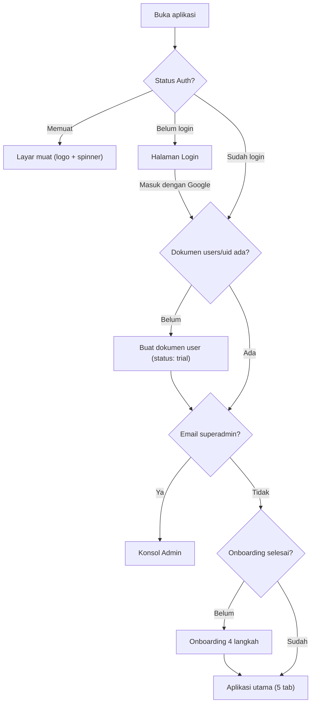
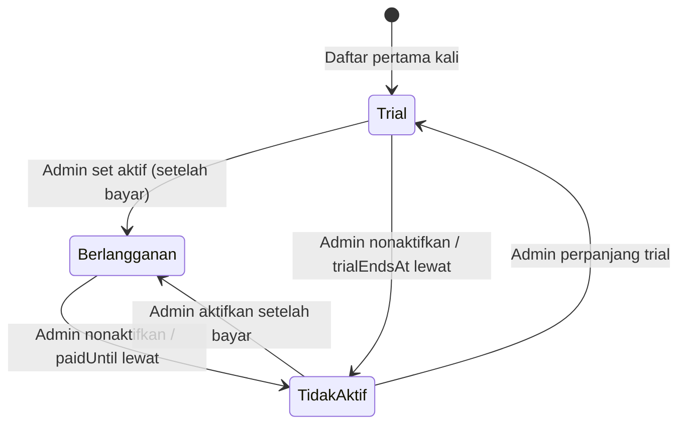

# PRODUCT REQUIREMENTS DOCUMENT (PRD) — FONDASI AKUN
## Login Google, Onboarding Pilih Usaha, Superadmin, Konsol Pemantauan User & Status Akun

> **Dokumen induk:** `PRD_Web_App_UMKM_Jepara.md` (aplikasi inti) dan `PRD_Modul_Mebel_Furniture.md` (ekstensi sektor mebel).
> **Status:** Draf siap dikerjakan. Keputusan produk sudah dikonfirmasi pemilik produk pada 11 November 2026 (lihat Bagian 17).
> **Superadmin awal:** `asa482@ums.ac.id`

---

## Daftar Isi

1. Latar Belakang & Tujuan
2. Ruang Lingkup & Urutan Pengerjaan
3. Arsitektur Teknis
4. Peran Pengguna (Role) & Mekanisme Superadmin
5. Status Akun (Fondasi Skema Pembayaran)
6. Fitur A1 — Halaman Login Google
7. Fitur A2 — Onboarding & Tutorial Pilih Usaha
8. Fitur A3 — Penyimpanan Data di Cloud Firestore
9. Fitur A4 — Konsol Admin (Pemantauan User)
10. Fitur A5 — Mode Baca-Saja untuk Akun Tidak Aktif
11. Fitur A6 — Log Audit & Akses "Lihat Data"
12. Perubahan pada Aplikasi yang Sudah Ada
13. Skema Data TypeScript & Struktur Firestore
14. Syarat Aturan Keamanan Firestore
15. Kriteria Penerimaan
16. Kasus Tepi
17. Keputusan yang Sudah Dikonfirmasi
18. Pertanyaan Terbuka
19. Di Luar Ruang Lingkup

---

## 1. Latar Belakang & Tujuan

Saat ini TITAN UMKM menyimpan semua data di `localStorage` browser. Akibatnya:

- Data hilang jika browser dibersihkan atau HP berganti.
- Satu usaha tidak bisa membuka datanya dari HP dan laptop sekaligus.
- Tim pendamping TI UMS tidak bisa memantau perkembangan UMKM binaan.
- Belum ada dasar untuk skema berlangganan saat aplikasi dipakai sungguhan.

**Tujuan fase ini:**

| No | Tujuan | Ukuran Berhasil |
| :--- | :--- | :--- |
| T1 | Pengguna masuk dengan 1 klik akun Google | Login sukses kurang dari 10 detik di HP Android dan iPhone |
| T2 | Pengguna baru langsung mendapat pengaturan sesuai jenis usahanya | Memilih "Mebel" langsung mengaktifkan preset Mebel & Kerajinan Kayu beserta fitur M1–M4 |
| T3 | Data usaha tersimpan aman di cloud dan sinkron antarperangkat | Data yang diubah di HP muncul di laptop tanpa muat ulang |
| T4 | Superadmin dan admin bisa memantau seluruh user | Daftar user, ringkasan aktivitas, dan status akun tampil di Konsol Admin |
| T5 | Ada status akun Aktif/Tidak Aktif sebagai fondasi pembayaran | Superadmin bisa menonaktifkan akun, dan akun itu otomatis menjadi baca-saja |

**Kebijakan masa trial (saat ini):** Semua yang mendaftar langsung mendapat **akses penuh** dengan status `Aktif – Trial` tanpa tanggal berakhir.

---

## 2. Ruang Lingkup & Urutan Pengerjaan

| Fase | Fitur | Prioritas | Bergantung pada |
| :--- | :--- | :--- | :--- |
| **A0** | Setup proyek Firebase (Auth, Firestore, Hosting) + konfigurasi `.env` | P0 | — |
| **A1** | Halaman Login Google + `AuthContext` + pembuatan dokumen user | P0 | A0 |
| **A2** | Onboarding 4 langkah (profil usaha, pilih usaha, persetujuan data, tutorial) | P0 | A1 |
| **A3** | Lapisan data Firestore (menggantikan `localStorage`) | P0 | A1 |
| **A4** | Peran & superadmin + aturan keamanan + Konsol Admin | P0 | A1, A3 |
| **A5** | Status akun + mode baca-saja | P0 | A4 |
| **A6** | Log audit + akses "Lihat Data" bertenggat waktu | P1 | A4 |

Urutan pengerjaan: `A0 → A1 → A3 → A2 → A4 → A5 → A6`. Lapisan data (A3) dikerjakan sebelum onboarding karena onboarding menulis profil usaha ke Firestore.

---

## 3. Arsitektur Teknis

### 3.1 Komponen

| Komponen | Pilihan | Alasan |
| :--- | :--- | :--- |
| Autentikasi | Firebase Authentication, penyedia Google | Tanpa password, sudah dipakai semua pemilik HP Android |
| Basis data | Cloud Firestore (mode Native) | Sinkron real-time, mendukung offline, aturan keamanan per dokumen |
| Hosting | Firebase Hosting (sudah disiapkan di `firebase.json`) | Satu proyek dengan Auth dan Firestore |
| Paket Firebase | **Spark (gratis)** | Tidak memakai Cloud Functions, jadi tidak wajib paket Blaze |
| SDK | `firebase` (modular v10+) | Tree-shaking, ukuran bundle kecil |

> [!IMPORTANT]
> Seluruh desain sengaja **tanpa Cloud Functions**. Peran superadmin, admin, dan pembatasan akun tidak aktif ditegakkan langsung oleh **Firestore Security Rules**, sehingga proyek tetap bisa berjalan di paket gratis.

### 3.2 Alur Masuk Aplikasi



### 3.3 Struktur Halaman (Tanpa Library Router)

Aplikasi saat ini tidak memakai router. Tambahkan state-machine sederhana di `App.tsx`:

| Kondisi | Tampilan |
| :--- | :--- |
| `authLoading === true` | `<SplashScreen />` |
| `user === null` | `<LoginPage />` |
| `isStaff && view === 'admin'` | `<AdminConsole />` |
| `!appUser.onboardingCompleted && !isStaff` | `<OnboardingFlow />` |
| lainnya | Aplikasi utama dengan 5 tab bottom bar seperti sekarang |

Path URL (`/admin`) cukup dibaca sekali saat muat agar tautan Konsol Admin bisa dibagikan. `firebase.json` sudah memiliki rewrite SPA.

### 3.4 File Baru

| File | Isi |
| :--- | :--- |
| `src/config/firebase.ts` | Inisialisasi app, Auth, Firestore dengan `persistentLocalCache` + `persistentMultipleTabManager` |
| `src/config/accessControl.ts` | Konstanta `SUPERADMIN_EMAIL`, versi persetujuan data |
| `src/types/account.ts` | Tipe `AppUser`, `UserRole`, `AccountStatus`, `AuditLog`, `AccessGrant` |
| `src/services/authService.ts` | `signInWithGoogle`, `signOutAndClearCache`, deteksi in-app browser |
| `src/services/userRepo.ts` | Buat/baca/perbarui dokumen `users/{uid}` |
| `src/services/workspaceRepo.ts` | CRUD koleksi data usaha + `onSnapshot` |
| `src/services/adminRepo.ts` | Daftar user, ubah status, kelola admin, tulis log audit |
| `src/utils/accountAccess.ts` | `getEffectiveAccess()` (fungsi murni) |
| `src/context/AuthContext.tsx` | State login, `appUser`, `role`, `access` |
| `src/components/auth/LoginPage.tsx` | Halaman login |
| `src/components/auth/InAppBrowserNotice.tsx` | Panel peringatan browser WhatsApp/Instagram |
| `src/components/onboarding/OnboardingFlow.tsx` + 4 langkah | Onboarding |
| `src/components/onboarding/TutorialSlides.tsx` | Tutorial (bisa diputar ulang dari Profil) |
| `src/components/admin/AdminConsole.tsx` | Kerangka konsol + 3 tab |
| `src/components/admin/UserList.tsx`, `UserStatusModal.tsx`, `AdminManager.tsx`, `AuditLogList.tsx` | Isi konsol |
| `src/components/layout/AccountStatusBanner.tsx` | Banner trial/tidak aktif |
| `firestore.rules`, `firestore.indexes.json` | Aturan keamanan & indeks |
| `.env.example` | Kunci `VITE_FIREBASE_*` |

---

## 4. Peran Pengguna (Role) & Mekanisme Superadmin

### 4.1 Tiga Peran

| Kemampuan | User | Admin | Superadmin |
| :--- | :---: | :---: | :---: |
| Memakai aplikasi untuk usahanya sendiri | Ya | Opsional | Opsional |
| Melihat daftar seluruh user & ringkasan aktivitas | — | Ya | Ya |
| Mengubah status akun user (Trial / Berlangganan / Tidak Aktif) | — | Ya | Ya |
| Mengatur tanggal akhir trial / masa berlangganan | — | Ya | Ya |
| Membuka "Lihat Data" user (baca-saja, tercatat di log) | — | Ya | Ya |
| Melihat log audit | — | Ya | Ya |
| Mengangkat / mencabut admin | — | — | Ya |
| Diubah statusnya atau dicabut perannya oleh orang lain | Ya | Oleh superadmin | **Tidak pernah** |
| Melihat tombol Portal Dosen & Uji Mock | — | Ya | Ya |

### 4.2 Pembuatan Superadmin (Bootstrap)

Superadmin **tidak dibuat lewat form**. Superadmin dikenali dari email Google yang sudah terverifikasi.

1. Konstanta di `src/config/accessControl.ts`:
   ```ts
   export const SUPERADMIN_EMAIL = 'asa482@ums.ac.id';
   ```
2. Email yang sama **ditulis langsung di `firestore.rules`** sebagai satu-satunya sumber kebenaran. Konstanta di klien hanya untuk menampilkan UI.
3. Saat `asa482@ums.ac.id` login pertama kali:
   - Dokumen `users/{uid}` dibuat dengan `role: 'superadmin'`, `accountStatus: 'active'`.
   - Aturan keamanan hanya mengizinkan `role: 'superadmin'` jika `request.auth.token.email == 'asa482@ums.ac.id'` **dan** `request.auth.token.email_verified == true`.
   - Superadmin langsung diarahkan ke **Konsol Admin** (tidak wajib onboarding).
4. Superadmin bisa membuat workspace usahanya sendiri lewat tombol **"Coba sebagai UMKM"** di Konsol Admin, yang menjalankan onboarding biasa.

**Mengapa aman:**

- Orang lain tidak bisa menjadi superadmin dengan mengubah field `role` miliknya, karena aturan keamanan memeriksa email dari token Google, bukan field di dokumen.
- Superadmin tidak bisa terkunci (dinonaktifkan atau dicabut) oleh admin mana pun.
- Mengganti superadmin di masa depan cukup dengan mengubah satu baris di `firestore.rules` lalu deploy ulang.

### 4.3 Pengangkatan Admin

- Hanya superadmin yang bisa mengangkat atau mencabut admin.
- Admin disimpan sebagai dokumen `admins/{uid}`. Keberadaan dokumen ini menjadi dasar pemeriksaan peran di aturan keamanan.
- Field `role` di `users/{uid}` ikut diperbarui dalam **satu batch** agar tampilan konsisten. Otoritasnya tetap dokumen `admins/{uid}`.
- Calon admin **wajib sudah pernah login** (punya dokumen user). Superadmin memilihnya dari daftar user dengan tombol **Jadikan Admin**.
- Setiap pengangkatan dan pencabutan ditulis ke log audit.

---

## 5. Status Akun (Fondasi Skema Pembayaran)

### 5.1 Tiga Status

| Status | Label UI | Akses | Kapan Dipakai |
| :--- | :--- | :--- | :--- |
| `trial` | **Aktif – Trial** | Penuh | Default setiap akun baru (fase saat ini) |
| `active` | **Aktif – Berlangganan** | Penuh | Nanti, setelah user membayar |
| `inactive` | **Tidak Aktif** | Baca-saja | Trial berakhir, langganan habis, atau dinonaktifkan admin |

### 5.2 Tanggal Kedaluwarsa (Opsional)

| Field | Arti | Default |
| :--- | :--- | :--- |
| `trialEndsAt` | Batas akhir trial | `null` (tanpa batas) |
| `paidUntil` | Batas akhir masa berlangganan | `null` |

Status efektif dihitung, **bukan dijalankan oleh penjadwal**. Trial yang lewat tanggal otomatis diperlakukan sebagai Tidak Aktif oleh aplikasi dan oleh aturan keamanan (`request.time`). Tidak perlu cron.



### 5.3 Fungsi Penentu Akses (Murni, Bisa Diuji)

```ts
// src/utils/accountAccess.ts
export function getEffectiveAccess(user: AppUser, now: Date = new Date()) {
  if (user.role === 'superadmin') {
    return { effectiveStatus: 'active' as const, canWrite: true, reason: null };
  }
  if (user.accountStatus === 'inactive') {
    return { effectiveStatus: 'inactive' as const, canWrite: false, reason: 'deactivated' as const };
  }
  if (user.accountStatus === 'trial' && user.trialEndsAt && now > new Date(user.trialEndsAt)) {
    return { effectiveStatus: 'inactive' as const, canWrite: false, reason: 'trial_expired' as const };
  }
  if (user.accountStatus === 'active' && user.paidUntil && now > new Date(user.paidUntil)) {
    return { effectiveStatus: 'inactive' as const, canWrite: false, reason: 'subscription_expired' as const };
  }
  return { effectiveStatus: user.accountStatus, canWrite: true, reason: null };
}
```

Logika yang sama wajib dicerminkan di `firestore.rules` (Bagian 14).

### 5.4 Ruang untuk Pembayaran Masa Depan

Field berikut **disiapkan sekarang tetapi belum dipakai UI**: `plan` (contoh `'bulanan'`, `'tahunan'`) dan `paymentNote` (catatan manual, misal nomor transfer). Integrasi payment gateway berada di luar ruang lingkup (Bagian 19).

---

## 6. Fitur A1 — Halaman Login Google

### 6.1 Isi Halaman

Mengikuti TITAN Design System (tanpa gradien ungu, ikon Font Awesome, tanpa emoji).

| Elemen | Isi |
| :--- | :--- |
| Ikon aplikasi | Lingkaran `bg-primary` dengan ikon `fa-solid fa-chart-simple` |
| Judul | **TITAN UMKM** |
| Subjudul | Hitung HPP, kelola pesanan, dan kendalikan mutu usaha dari satu aplikasi. |
| Tombol utama | `fa-brands fa-google` + **Masuk dengan Google** (lebar penuh, tinggi min 48px) |
| Catatan kecil | Didampingi Program Studi Teknik Industri, Universitas Muhammadiyah Surakarta. |
| Tautan | **Kebijakan Privasi** (membuka lembar ringkas di modal) |

### 6.2 Metode Login

| Kondisi | Metode |
| :--- | :--- |
| Browser desktop | `signInWithPopup` |
| HP, atau PWA mode standalone (`display-mode: standalone`) | `signInWithRedirect` (popup sering diblokir di iOS standalone) |
| Popup gagal dengan kode `auth/popup-blocked` | Otomatis beralih ke `signInWithRedirect` |

- Persistensi sesi: `browserLocalPersistence`. User tetap masuk setelah HP dimatikan.
- Hanya penyedia Google yang diaktifkan.

### 6.3 Peringatan Browser di Dalam Aplikasi (Penting untuk UMKM)

Tautan aplikasi kemungkinan besar dibagikan lewat **grup WhatsApp**. Google **menolak login** dari browser bawaan WhatsApp, Instagram, Facebook, dan TikTok (`disallowed_useragent`).

- Deteksi `navigator.userAgent` mengandung `FBAN`, `FBAV`, `Instagram`, `Line/`, `TikTok`, atau WebView Android (`; wv)`).
- Jika terdeteksi, **sembunyikan tombol Google** dan tampilkan `<InAppBrowserNotice />`:
  - Judul: **Buka di Chrome atau Safari**
  - Isi: Login Google tidak bisa dilakukan dari dalam WhatsApp. Ketuk ikon titik tiga di kanan atas, lalu pilih *Buka di Chrome* (Android) atau *Buka di Safari* (iPhone).
  - Tombol **Salin Tautan** (menyalin URL aplikasi).

### 6.4 Pesan Galat

| Kode Firebase | Pesan ke User |
| :--- | :--- |
| `auth/popup-closed-by-user` | Login dibatalkan. Ketuk tombol lagi untuk mencoba. |
| `auth/network-request-failed` | Tidak ada koneksi internet. Login pertama kali membutuhkan internet. |
| `auth/unauthorized-domain` | Domain belum diizinkan. Hubungi admin. (Muncul jika domain belum didaftarkan di Firebase Console) |
| Lainnya | Login gagal. Coba lagi beberapa saat lagi. |

### 6.5 Keluar (Logout)

- Tombol **Keluar** berada di tab **Profil** (bukan di header), sesuai pola menu profil di bottom bar yang sudah disepakati.
- Konfirmasi: *Keluar dari akun ini? Data tetap tersimpan aman di akun Google Anda.*
- Setelah keluar, panggil `terminate(db)` lalu `clearIndexedDbPersistence(db)` agar data usaha **tidak tertinggal di HP bersama** (umum di bengkel atau warung).

---

## 7. Fitur A2 — Onboarding & Tutorial Pilih Usaha

Muncul sekali setelah login pertama, untuk user dengan `onboardingCompleted === false`. Langkah terakhir yang sudah dicapai disimpan di `users/{uid}.onboardingStep` agar user bisa melanjutkan jika aplikasi tertutup di tengah jalan.

Indikator progres di atas: 4 titik, tanpa angka persen.

### 7.1 Langkah 1 — Profil Usaha

| Field | Aturan | Isi Awal |
| :--- | :--- | :--- |
| Nama pemilik | Wajib, 2–60 karakter | `displayName` dari Google |
| Nama usaha | Wajib, 2–80 karakter | Kosong |
| Nomor WhatsApp | Wajib, diawali `62`, 10–15 digit. Input `08…` otomatis diubah menjadi `628…` | Kosong |
| Kota / kabupaten | Opsional | Kosong |

Tombol: **Lanjut**.

### 7.2 Langkah 2 — Pilih Jenis Usaha

Empat kartu pilihan (satu kolom di HP, 2x2 grid di desktop). Kartu terpilih memakai border `primary` 2px dan ikon centang.

| Kartu | Ikon | Deskripsi Singkat | Hasil |
| :--- | :--- | :--- | :--- |
| **Mebel & Kerajinan Kayu** | `fa-solid fa-couch` | Kursi, meja, lemari, ukiran, kusen kayu | `sector = 'mebel'` |
| **Kuliner & Makanan Olahan** | `fa-solid fa-utensils` | Katering, kue, keripik, frozen food, warung | `sector = 'fnb'` |
| **Fashion, Konveksi & Batik** | `fa-solid fa-shirt` | Pakaian, gamis, batik tulis/cap, tas kain, jahit | `sector = 'fashion'` |
| **Usaha Lainnya** | `fa-solid fa-shop` | Kerajinan non-kayu, percetakan, jasa, dan lainnya | `sector = 'custom'` |

Jika memilih **Usaha Lainnya**, muncul input wajib **"Jenis usaha Anda"** (2–40 karakter, contoh: *Percetakan undangan*, *Kerajinan gerabah*). Disimpan di `businessTypeLabel` dan ditampilkan di header menggantikan nama preset "Usaha Produksi / Umum".

### 7.3 Langkah 3 — Pengaturan yang Diaktifkan + Persetujuan Data

**Bagian atas: ringkasan otomatis sesuai pilihan.**

Untuk **Mebel & Kerajinan Kayu**, tampilkan daftar (ikon centang, satu baris per butir):

- Kalkulator kubikasi kayu (daftar potong papan)
- Termin bayar 3 tahap: DP 50%, barang mentah 30%, pelunasan 20%
- Surat penawaran harga berlaku 14 hari
- Upah borongan & kasbon tukang
- Daftar jenis cacat kayu dan checklist mutu mebel

Untuk **Kuliner & Makanan Olahan**:
- Perhitungan HPP per batch/porsi layak jual (tanpa double-counting susut)
- Daftar cacat kuliner (gosong, rasa asam, basi, salah resep)
- Checklist titik kritis halal & kebersihan sanitasi dapur

Untuk **Fashion, Konveksi & Batik**:
- Perhitungan HPP per potong / lusin pakaian
- Kalkulasi susut bahan baku kain meteran (wastage)
- Alokasi ongkos jahit, obras, dan sablon/bordir per unit
- Checklist kendali mutu jahit, obras, dan ketahanan warna batik

Untuk **Usaha Lainnya**:
- Perhitungan HPP modular per unit
- Pencatatan kerugian cacat produksi umum (5M Fishbone)
- Checklist kendali mutu dan SOP dasar usaha

Kalimat penutup: *Pengaturan ini bisa diubah kapan saja di menu Profil.*

**Bagian bawah: persetujuan data (wajib dicentang).**

> Saya setuju data usaha saya disimpan di layanan cloud Google (Firebase) dan dapat dipantau oleh tim pendamping Teknik Industri UMS untuk keperluan pendampingan usaha. Setiap pembukaan data detail oleh tim pendamping akan tercatat.

- Tombol **Lanjut** nonaktif sampai kotak dicentang.
- Simpan `consentAcceptedAt` dan `consentVersion: '2026-11-v1'`.
- Tautan **Baca kebijakan privasi lengkap**.

> [!NOTE]
> Persetujuan ini diperlukan karena superadmin dan admin bisa membuka data usaha user. Ini sejalan dengan prinsip persetujuan dan transparansi dalam UU No. 27 Tahun 2022 tentang Pelindungan Data Pribadi.

### 7.4 Langkah 4 — Tutorial Singkat

4 slide geser (swipe di HP, tombol panah di desktop). Teks menyesuaikan sektor. Tombol **Lewati** selalu terlihat di kanan atas.

| Slide | Ikon | Judul | Isi (contoh untuk Mebel) |
| :--- | :--- | :--- | :--- |
| 1 | `fa-boxes-stacked` | Hitung HPP dengan benar | Masukkan ukuran kayu per komponen. Aplikasi menghitung kubikasi, susut kayu, upah, dan cadangan cacat sampai ketemu harga jual aman. |
| 2 | `fa-clipboard-list` | Catat pesanan & termin | Buat penawaran, ubah jadi pesanan, lalu tagih DP, termin, dan pelunasan lewat WhatsApp. |
| 3 | `fa-shield-halved` | Kendalikan cacat | Catat kayu retak, finishing belang, atau komplain. Aplikasi menghitung uang yang bocor. |
| 4 | `fa-chart-simple` | Lihat rapor usaha | Laba bersih riil, piutang, upah tukang, dan masalah mutu terbesar dalam satu halaman. |

Tombol terakhir: **Mulai Pakai TITAN**.

### 7.5 Yang Terjadi Saat Onboarding Selesai (Satu Batch Firestore)

1. Tulis `workspaces/{uid}` berisi `BusinessProfile` (nama, pemilik, telepon, `sector`, `trainingModeEnabled: false`).
2. Tulis checklist awal dari `SECTOR_PRESETS[sector].defaultChecklists` ke `workspaces/{uid}/checklists`.
3. Perbarui `users/{uid}`: `onboardingCompleted: true`, `sector`, `businessName`, `businessTypeLabel`.
4. Arahkan ke tab **Produk & HPP** dengan kartu kosong bertuliskan *Input Produk Pertama*.

Data contoh (seed mock) **tidak** dimasukkan ke akun asli.

### 7.6 Memutar Ulang Tutorial

Di tab **Profil**, tambahkan tombol **Lihat Tutorial Lagi** yang membuka `<TutorialSlides />` sebagai modal.

---

## 8. Fitur A3 — Penyimpanan Data di Cloud Firestore

### 8.1 Prinsip

- Satu workspace per akun: `workspaces/{uid}`.
- Setiap entitas disimpan **sebagai dokumen terpisah di subkoleksi**, bukan satu dokumen besar. Alasannya: batas ukuran dokumen Firestore 1 MiB, dan setiap aksi di `UmkmContext` memang mengubah satu entitas.
- Mesin kalkulasi (`calculations.ts`, `furnitureCalculations.ts`) **tidak berubah sama sekali**.
- Mode offline aktif. Bengkel dan warung sering bersinyal lemah. Perubahan saat offline disimpan lokal dan dikirim otomatis saat sinyal kembali.

### 8.2 Pemetaan State Lama ke Firestore

| State di `UmkmContext` | Lokasi Firestore |
| :--- | :--- |
| `profile` | `workspaces/{uid}` (dokumen induk) |
| `products` | `workspaces/{uid}/products/{productId}` |
| `orders` | `workspaces/{uid}/orders/{orderId}` |
| `defects` | `workspaces/{uid}/defects/{defectId}` |
| `checklists` | `workspaces/{uid}/checklists/{itemId}` |
| `quotations` | `workspaces/{uid}/quotations/{quoteId}` |
| `craftsmen` | `workspaces/{uid}/craftsmen/{craftsmanId}` |
| `laborContracts` | `workspaces/{uid}/laborContracts/{contractId}` |
| `laborPayments` | `workspaces/{uid}/laborPayments/{paymentId}` |

### 8.3 Perubahan `UmkmContext`

- `UmkmProvider` menerima prop `workspaceUid` dan `readOnly`. Ini memungkinkan komponen yang sama dipakai untuk mode "Lihat Data" admin (Bagian 11).
- `useState` + `localStorage` diganti `onSnapshot` per subkoleksi. State React tetap menjadi sumber render.
- Setiap aksi (contoh `addProduct`, `updateOrder`, `addLaborPayment`) menulis ke Firestore. UI diperbarui oleh `onSnapshot`, bukan oleh `setState` manual.
- Aksi yang mengubah banyak dokumen sekaligus memakai `writeBatch`. Contoh: `syncMaterialPriceAcrossProducts` dan `convertQuotationToOrder`.
- Nomor dokumen (`ORD-…`, `QUO-…`) dibuat dengan `generateDocNumber` dari data terbaru di snapshot.
- `broadcastStateUpdate` / `subscribeToDualSync` (BroadcastChannel) **tidak dipakai lagi** untuk akun login. Sinkron antartab dan antarperangkat sudah ditangani Firestore.
- Setiap fungsi aksi memeriksa `access.canWrite` di awal. Jika `false`, aksi dibatalkan dan menampilkan pesan mode baca-saja (Bagian 10).

### 8.4 Ringkasan Statistik untuk Konsol Admin

Agar Konsol Admin cukup membaca satu koleksi `users`, klien menulis ringkasan ke `users/{uid}.stats` setiap kali data berubah, dengan **debounce 30 detik**:

| Field | Rumus |
| :--- | :--- |
| `productCount` | Jumlah produk |
| `orderCount` | Jumlah pesanan non-batal |
| `activeOrderCount` | Pesanan belum `Selesai` dan belum `Dibatalkan` |
| `totalProductRevenue` | `generateFinancialReport(orders, defects).totalProductRevenue` |
| `defectCount` | Jumlah catatan cacat |
| `updatedAt` | Waktu server |

`lastActiveAt` diperbarui saat aplikasi dibuka, paling sering 1 kali per jam.

> [!NOTE]
> Karena ditulis oleh klien, angka `stats` bersifat indikatif untuk pemantauan, bukan angka audit keuangan. Angka pasti didapat lewat "Lihat Data".

### 8.5 Perkiraan Kuota Paket Gratis

| Batas Spark per hari | Perkiraan pemakaian per user aktif | Kapasitas |
| :--- | :--- | :--- |
| 50.000 baca | Sekitar 150–300 baca (snapshot awal + perubahan) | Sekitar 150 user aktif per hari |
| 20.000 tulis | Sekitar 30–80 tulis | Lebih dari 250 user aktif per hari |

Jika user aktif harian melebihi sekitar 150, pindah ke paket Blaze (bayar sesuai pemakaian; biaya per user tetap kecil).

---

## 9. Fitur A4 — Konsol Admin (Pemantauan User)

### 9.1 Akses

- Tombol **Konsol Admin** (`fa-solid fa-user-shield`) di header, hanya untuk admin dan superadmin. Tombol ini menggantikan posisi tombol "Portal Dosen" dan "Uji Mock".
- Portal Dosen dan Uji Mock tetap ada, dipindah ke dalam Konsol Admin sebagai tautan di bagian bawah.
- Konsol Admin memiliki layout sendiri (tanpa bottom bar 5 tab) dengan tombol **Kembali ke Aplikasi** jika staf punya workspace sendiri.

### 9.2 Tiga Tab Konsol

| Tab | Isi | Siapa |
| :--- | :--- | :--- |
| **Pengguna** | Ringkasan angka + daftar user + aksi | Admin, Superadmin |
| **Tim Admin** | Daftar admin + angkat/cabut | Superadmin saja |
| **Log Audit** | Riwayat aksi staf | Admin, Superadmin |

### 9.3 Tab Pengguna — Ringkasan Angka

Satu baris grid datar (4 angka, tanpa kartu bersarang):

| Angka | Rumus |
| :--- | :--- |
| Total Pengguna | Jumlah dokumen user dengan `role = 'user'` |
| Aktif 7 Hari Terakhir | `lastActiveAt` dalam 7 hari terakhir |
| Per Jenis Usaha | Contoh: Mebel 12 · Kuliner 8 · Lainnya 3 |
| Tidak Aktif | Jumlah dengan status efektif `inactive` |

### 9.4 Tab Pengguna — Daftar

**Filter:** cari (nama, email, nama usaha), status (Semua / Trial / Berlangganan / Tidak Aktif), jenis usaha, urutan (Terakhir aktif / Terbaru daftar / Omzet terbesar).

**Satu kartu per user (HP) atau satu baris tabel (desktop):**

| Kolom | Contoh |
| :--- | :--- |
| Foto + nama + email | Bambang Siswanto · bambang@gmail.com |
| Nama usaha + jenis usaha | Jati Luhur Furniture · Mebel |
| Status | Badge `Aktif – Trial` (emas), `Aktif – Berlangganan` (primary), `Tidak Aktif` (abu, merah muda) |
| Akhir trial / langganan | `Tanpa batas` atau `31 Des 2026` |
| Aktivitas | 6 produk · 4 pesanan · Omzet Rp 11.850.000 |
| Terakhir aktif | `2 jam lalu` |
| Terdaftar | `10 Nov 2026` |
| Onboarding | Badge `Belum selesai` jika `onboardingCompleted === false` |

**Pemuatan:** 50 user per halaman dengan tombol **Muat Lebih Banyak** (`startAfter`).

**Aksi per user (menu titik tiga):**

| Aksi | Keterangan |
| :--- | :--- |
| **Ubah Status** | Buka `<UserStatusModal />` |
| **Lihat Data** | Buka mode pantau baca-saja (Bagian 11) |
| **Hubungi via WhatsApp** | `wa.me/{phone}` jika nomor tersedia |
| **Jadikan Admin** / **Cabut Admin** | Superadmin saja |

### 9.5 Modal Ubah Status

| Field | Aturan |
| :--- | :--- |
| Status baru | Pilihan: Aktif – Trial / Aktif – Berlangganan / Tidak Aktif |
| Akhir trial | Muncul jika Trial. Pilihan cepat: *Tanpa batas*, *+14 hari*, *+30 hari*, *Pilih tanggal* |
| Berlangganan sampai | Muncul jika Berlangganan. Pilihan cepat: *+1 bulan*, *+1 tahun*, *Tanpa batas*, *Pilih tanggal* |
| Paket | Opsional (teks bebas, untuk masa depan) |
| Alasan | **Wajib**, 5–200 karakter. Contoh: *Pembayaran bulan Desember diterima* |

- Tombol: **Simpan Status**. Jika status baru `Tidak Aktif`, tampilkan konfirmasi: *User ini tidak akan bisa menambah atau mengubah data sampai diaktifkan lagi. Lanjutkan?*
- Perubahan status dan log audit ditulis dalam **satu batch**.
- Akun superadmin tidak menampilkan aksi ini.

### 9.6 Tab Tim Admin

- Daftar admin: nama, email, diangkat oleh, tanggal diangkat.
- Tombol **+ Tambah Admin** membuka pencarian user yang sudah terdaftar berdasarkan email.
- **Cabut Admin** dengan konfirmasi. Admin yang dicabut kembali menjadi `user` dan statusnya tidak berubah.
- Baris superadmin selalu di paling atas dengan badge **Superadmin** dan tanpa tombol aksi.

---

## 10. Fitur A5 — Mode Baca-Saja untuk Akun Tidak Aktif

### 10.1 Banner Status (Di Bawah Header)

| Kondisi | Banner |
| :--- | :--- |
| Trial tanpa batas | Tidak ada banner |
| Trial dengan tanggal akhir, sisa 7 hari atau kurang | Kuning: *Masa trial berakhir dalam 5 hari (16 Nov 2026).* |
| Tidak Aktif | Abu tegas: ikon `fa-lock` + *Akun Anda tidak aktif. Data tetap bisa dilihat dan diunduh, tetapi tidak bisa ditambah atau diubah.* + tombol **Hubungi Admin** (WhatsApp: `+6285196436006`) |

Banner diperbarui real-time lewat `onSnapshot` ke `users/{uid}`. Jika admin mengaktifkan akun, banner hilang tanpa muat ulang. Tombol **Hubungi Admin** otomatis membuka tautan `https://wa.me/6285196436006?text=Halo%20Admin%20TITAN%20UMKM%2C%20saya%20ingin%20mengaktifkan%20kembali%20akun%20saya`.

### 10.2 Perilaku Tombol

| Jenis Aksi | Saat Tidak Aktif |
| :--- | :--- |
| Lihat produk, pesanan, cacat, rapor | Boleh |
| Kirim nota / tagihan / penawaran via WhatsApp | Boleh (tidak mengubah data) |
| Unduh data (Bagian 10.3) | Boleh |
| Tambah, edit, hapus, ubah tahap, catat bayar, centang checklist | **Dinonaktifkan**. Tombol tampil abu dengan ikon gembok kecil. Jika diketuk: *Akun tidak aktif. Hubungi admin untuk mengaktifkan kembali.* |
| Ubah profil usaha & sektor | Dinonaktifkan |
| Keluar, lihat tutorial | Boleh |

Pertahanan berlapis: tombol dinonaktifkan di UI, aksi di `UmkmContext` memeriksa `access.canWrite`, dan **aturan keamanan Firestore menolak penulisan** meskipun UI dilewati.

### 10.3 Unduh Data

Tombol **Unduh Data Usaha (JSON)** di tab Profil, tersedia untuk semua status. Isinya seluruh subkoleksi workspace dalam satu file `titan-{namaUsaha}-{YYYYMMDD}.json`. Ini menjamin user tetap memiliki datanya walaupun akun tidak aktif.

---

## 11. Fitur A6 — Log Audit & Akses "Lihat Data"

### 11.1 Aksi yang Wajib Dicatat

| `action` | Pemicu |
| :--- | :--- |
| `change_status` | Ubah status akun / tanggal trial / tanggal langganan |
| `view_user_data` | Membuka "Lihat Data" |
| `grant_admin` | Mengangkat admin |
| `revoke_admin` | Mencabut admin |

Setiap entri berisi pelaku (uid, email), target (uid, email, nama usaha), nilai sebelum dan sesudah, alasan, dan waktu server.

Log audit **hanya bisa ditambah**. Tidak ada yang bisa mengubah atau menghapus, termasuk superadmin.

### 11.2 Alur "Lihat Data"

1. Staf menekan **Lihat Data** pada seorang user.
2. Modal meminta alasan: *Pendampingan rutin* / *Bantuan teknis atas permintaan user* / *Verifikasi pembayaran* / *Lainnya (isi)*.
3. Klien menulis **dalam satu batch**:
   - Dokumen log audit baru (`view_user_data`).
   - Dokumen izin akses `accessGrants/{staffUid}/targets/{targetUid}` berisi `expiresAt = sekarang + 2 jam` dan `auditLogId`.
4. Aturan keamanan hanya mengizinkan staf **membaca** workspace target jika izin akses masih berlaku **dan** log audit yang dirujuk benar-benar ada. Staf tidak pernah bisa menulis ke workspace user.
5. Aplikasi membuka `UmkmProvider workspaceUid={targetUid} readOnly` dengan 5 tab seperti biasa, ditambah banner tetap berwarna `accent-dark`:
   *Mode Pantau — Anda melihat data Jati Luhur Furniture (baca-saja). Akses berakhir pukul 10.42.* + tombol **Tutup**.
6. Setelah 2 jam, pembacaan ditolak. Staf harus membuka ulang dengan alasan baru (tercatat lagi).

### 11.3 Tab Log Audit

- Daftar terbaru di atas, 50 per halaman.
- Filter: jenis aksi, pelaku, target (email).
- Format baris: *10 Nov 2026 09.42 · asa482@ums.ac.id mengubah status bambang@gmail.com: Trial → Tidak Aktif. Alasan: Trial berakhir.*

---

## 12. Perubahan pada Aplikasi yang Sudah Ada

| Bagian | Perubahan |
| :--- | :--- |
| `Header.tsx` | User biasa: tombol Portal Dosen & Uji Mock disembunyikan. Staf: tombol **Konsol Admin**. Nama usaha memakai `businessTypeLabel` jika sektor `custom` |
| `ProfileModule.tsx` | Tambah kartu **Akun**: foto, email, badge status, tanggal akhir trial. Tambah tombol **Lihat Tutorial Lagi**, **Unduh Data Usaha**, **Keluar**. Toggle Mode Pelatihan tetap ada |
| `MockControlDrawer.tsx` | Hanya bisa dibuka staf. Untuk akun login, aksi ganti persona & reset data bekerja di workspace staf sendiri dengan konfirmasi keras |
| `LecturerMonitoring.tsx` | Hanya staf. Isi tidak berubah pada fase ini |
| `HomeworkBanner.tsx` | Tidak berubah. Muncul jika `trainingModeEnabled` dinyalakan user dari Profil |
| `UmkmContext.tsx` | Lihat Bagian 8.3 |
| `mockSeedData.ts` | Tetap ada untuk Uji Mock staf. Tidak dimuat ke akun baru |
| `firebase.json` | Tambah blok `firestore` (`rules`, `indexes`) |
| Firebase Console | Aktifkan penyedia Google. Tambahkan domain `*.web.app`, `*.firebaseapp.com`, dan `localhost` ke **Authorized domains** |

---

## 13. Skema Data TypeScript & Struktur Firestore

### 13.1 `src/types/account.ts`

```ts
import { SectorId } from './titan';

export type UserRole = 'superadmin' | 'admin' | 'user';
export type AccountStatus = 'trial' | 'active' | 'inactive';
export type AccessReason = 'deactivated' | 'trial_expired' | 'subscription_expired' | null;

export interface UserStats {
  productCount: number;
  orderCount: number;
  activeOrderCount: number;
  totalProductRevenue: number;
  defectCount: number;
  updatedAt: string;            // ISO (Timestamp di Firestore)
}

export interface AppUser {
  uid: string;
  email: string;
  displayName: string;
  photoURL?: string;
  phone?: string;

  // Peran (tampilan). Otoritas ada di firestore.rules + koleksi admins.
  role: UserRole;

  // Status akun
  accountStatus: AccountStatus;
  trialEndsAt: string | null;   // null = tanpa batas
  paidUntil: string | null;
  plan?: string | null;         // disiapkan untuk masa depan
  paymentNote?: string | null;
  statusNote?: string;          // alasan perubahan terakhir
  statusUpdatedBy?: string;     // email staf
  statusUpdatedAt?: string;

  // Onboarding
  onboardingCompleted: boolean;
  onboardingStep: number;       // 1..4
  consentAcceptedAt?: string;
  consentVersion?: string;      // '2026-11-v1'

  // Ringkasan usaha
  sector?: SectorId;
  businessName?: string;
  businessTypeLabel?: string;   // diisi jika sector === 'custom'
  city?: string;
  stats?: UserStats;

  createdAt: string;
  lastActiveAt: string;
}

export type AuditAction = 'change_status' | 'view_user_data' | 'grant_admin' | 'revoke_admin';

export interface AuditLog {
  id: string;
  action: AuditAction;
  actorUid: string;
  actorEmail: string;
  targetUid: string;
  targetEmail: string;
  targetBusinessName?: string;
  before?: Record<string, unknown>;
  after?: Record<string, unknown>;
  reason: string;
  createdAt: string;
}

export interface AccessGrant {
  targetUid: string;
  auditLogId: string;
  expiresAt: string;            // maksimal 2 jam dari waktu pembuatan
  createdAt: string;
}

export interface AdminRecord {
  uid: string;
  email: string;
  grantedByEmail: string;
  grantedAt: string;
}
```

Catatan: tanggal disimpan sebagai Firestore `Timestamp` agar bisa dibandingkan dengan `request.time` di aturan keamanan. Lapisan repo mengubahnya ke string ISO untuk komponen React.

### 13.2 Struktur Koleksi

```text
users/{uid}                              AppUser
admins/{uid}                             AdminRecord
auditLogs/{logId}                        AuditLog
accessGrants/{staffUid}/targets/{targetUid}   AccessGrant
workspaces/{uid}                         BusinessProfile
workspaces/{uid}/products/{id}           Product
workspaces/{uid}/orders/{id}             Order
workspaces/{uid}/defects/{id}            DefectLog
workspaces/{uid}/checklists/{id}         ChecklistItem
workspaces/{uid}/quotations/{id}         Quotation
workspaces/{uid}/craftsmen/{id}          Craftsman
workspaces/{uid}/laborContracts/{id}     LaborContract
workspaces/{uid}/laborPayments/{id}      LaborPayment
```

### 13.3 Indeks Komposit

| Koleksi | Field |
| :--- | :--- |
| `users` | `role` ASC, `lastActiveAt` DESC |
| `users` | `role` ASC, `createdAt` DESC |
| `users` | `accountStatus` ASC, `lastActiveAt` DESC |
| `auditLogs` | `targetUid` ASC, `createdAt` DESC |
| `auditLogs` | `action` ASC, `createdAt` DESC |

---

## 14. Syarat Aturan Keamanan Firestore

> [!IMPORTANT]
> File `firestore.rules` akan disusun oleh spesialis aturan keamanan saat implementasi. Bagian ini adalah **daftar syarat wajib** yang harus dipenuhi aturan tersebut.

### 14.1 Fungsi Bantu yang Dibutuhkan

| Fungsi | Arti |
| :--- | :--- |
| `isSignedIn()` | `request.auth != null` |
| `isSuperadmin()` | Email token `asa482@ums.ac.id` **dan** `email_verified == true` |
| `isAdmin()` | Dokumen `admins/{request.auth.uid}` ada |
| `isStaff()` | `isSuperadmin() \|\| isAdmin()` |
| `isOwner(uid)` | `request.auth.uid == uid` |
| `hasWriteAccess(uid)` | Superadmin, **atau** status di `users/{uid}` bukan `inactive` dan `trialEndsAt` / `paidUntil` belum lewat dari `request.time` |
| `hasValidGrant(targetUid)` | Dokumen `accessGrants/{request.auth.uid}/targets/{targetUid}` ada dan `expiresAt > request.time` |

### 14.2 Syarat per Koleksi

| Koleksi | Baca | Buat | Ubah | Hapus |
| :--- | :--- | :--- | :--- | :--- |
| `users/{uid}` | Pemilik, Staf | Pemilik saja. `role` harus `'user'` (atau `'superadmin'` jika `isSuperadmin()`). `accountStatus` harus `'trial'` (superadmin `'active'`). `trialEndsAt` dan `paidUntil` harus `null` | **Pemilik:** hanya field profil, onboarding, persetujuan, `stats`, `lastActiveAt`. **Staf:** hanya field status (`accountStatus`, `trialEndsAt`, `paidUntil`, `plan`, `paymentNote`, `statusNote`, `statusUpdatedBy`, `statusUpdatedAt`). **Superadmin:** boleh ubah `role`. Dokumen milik superadmin tidak bisa diubah statusnya oleh siapa pun | Tidak ada |
| `admins/{uid}` | Staf | Superadmin saja | Superadmin saja | Superadmin saja. Tidak boleh untuk uid superadmin |
| `auditLogs/{id}` | Staf | Staf. `actorUid == request.auth.uid`. `createdAt == request.time` | **Tidak ada** | **Tidak ada** |
| `accessGrants/{staffUid}/targets/{targetUid}` | Staf pemilik grant | Staf dengan `staffUid == request.auth.uid`. `expiresAt <= request.time + 2 jam`. Dokumen log audit pada `auditLogId` harus ada dalam batch yang sama (`getAfter`) dengan `action == 'view_user_data'`, `actorUid` dan `targetUid` cocok | Sama dengan buat | Staf pemilik grant |
| `workspaces/{uid}` dan seluruh subkoleksinya | Pemilik, **atau** Staf dengan `hasValidGrant(uid)` | Pemilik dengan `hasWriteAccess(uid)` | Pemilik dengan `hasWriteAccess(uid)` | Pemilik dengan `hasWriteAccess(uid)` |

### 14.3 Syarat Tambahan

- Semua koleksi lain ditolak secara default.
- Validasi tipe dasar pada field status (`accountStatus` hanya 3 nilai, `role` hanya 3 nilai).
- Batas panjang string untuk `reason` (maks 200) dan field profil.
- Uji aturan dengan Firebase Emulator untuk minimal skenario di Bagian 15.4.

---

## 15. Kriteria Penerimaan

### 15.1 A1 — Login

| No | Skenario | Hasil yang Diharapkan |
| :--- | :--- | :--- |
| 1 | User baru menekan **Masuk dengan Google** di Chrome Android | Login berhasil, dokumen `users/{uid}` dibuat dengan `accountStatus: 'trial'`, `trialEndsAt: null`, masuk ke Onboarding langkah 1 |
| 2 | Membuka tautan dari dalam WhatsApp | Tombol Google tersembunyi, muncul panel **Buka di Chrome atau Safari** + tombol Salin Tautan |
| 3 | PWA terpasang di iPhone (standalone) | Login memakai redirect, berhasil kembali ke aplikasi |
| 4 | Menekan **Keluar** di Profil | Kembali ke halaman login. Cache Firestore lokal terhapus |
| 5 | Membuka aplikasi lagi setelah HP dimatikan | Tetap masuk tanpa login ulang |

### 15.2 A2 — Onboarding

| No | Skenario | Hasil yang Diharapkan |
| :--- | :--- | :--- |
| 1 | Memilih **Mebel & Kerajinan Kayu** dan menyelesaikan onboarding | `profile.sector === 'mebel'`. Header menampilkan *Mebel & Kerajinan Kayu*. Panel kubikasi muncul di form produk. Segmen *Surat Penawaran* dan *Upah Borongan & Kasbon* muncul di tab Pesanan. Pesanan baru memakai termin 50/30/20. Checklist mebel terisi |
| 2 | Memilih **Kuliner** | `sector === 'fnb'`. Fitur M1–M4 tidak muncul. Checklist kuliner terisi |
| 3 | Memilih **Usaha Lainnya**, mengetik *Batik Tulis* | `sector === 'custom'`, `businessTypeLabel === 'Batik Tulis'`, header menampilkan *Batik Tulis* |
| 4 | Memilih Lainnya tanpa mengisi jenis usaha | Tombol Lanjut nonaktif |
| 5 | Tidak mencentang persetujuan data | Tombol Lanjut nonaktif |
| 6 | Menutup aplikasi di langkah 3, membuka lagi | Lanjut di langkah 3 dengan isian langkah 1–2 tetap ada |
| 7 | Menekan **Lewati** di tutorial | Onboarding selesai, masuk ke tab Produk & HPP |
| 8 | Nomor diketik `081234567890` | Disimpan sebagai `6281234567890` |

### 15.3 A4–A6 — Superadmin, Admin, Status, Audit

| No | Skenario | Hasil yang Diharapkan |
| :--- | :--- | :--- |
| 1 | `asa482@ums.ac.id` login pertama kali | `role: 'superadmin'`, `accountStatus: 'active'`, langsung ke Konsol Admin |
| 2 | User biasa mencoba menulis `role: 'superadmin'` ke dokumennya lewat konsol browser | Ditolak aturan keamanan |
| 3 | User biasa mencoba membaca `users` milik orang lain | Ditolak |
| 4 | Superadmin mengangkat user B menjadi admin | `admins/{B}` dibuat, `users/{B}.role = 'admin'`, log `grant_admin` tercatat. B melihat tombol Konsol Admin tanpa muat ulang |
| 5 | Admin B mencoba mengangkat admin lain atau mencabut superadmin | Tombol tidak ada. Penulisan langsung ditolak aturan |
| 6 | Admin mengubah user C menjadi **Tidak Aktif** dengan alasan | Status tersimpan, log `change_status` berisi sebelum/sesudah. Di HP user C banner gembok muncul real-time, semua tombol tambah/ubah nonaktif |
| 7 | User C (tidak aktif) mencoba `addDoc` produk lewat konsol browser | Ditolak aturan keamanan |
| 8 | User C menekan **Unduh Data Usaha** | File JSON terunduh berisi seluruh data |
| 9 | Admin set trial user D berakhir kemarin | User D langsung baca-saja tanpa menunggu proses terjadwal |
| 10 | Admin mengaktifkan kembali user C | Banner hilang, tombol aktif lagi tanpa muat ulang |
| 11 | Admin membuka **Lihat Data** user E dengan alasan | Log `view_user_data` + grant 2 jam tercatat. Data E tampil dengan banner Mode Pantau. Semua tombol ubah nonaktif |
| 12 | Admin mencoba membaca workspace E tanpa grant | Ditolak aturan keamanan |
| 13 | Admin mencoba mengubah atau menghapus log audit | Ditolak aturan keamanan |
| 14 | Data diubah di HP, laptop dengan akun sama terbuka | Perubahan muncul di laptop dalam beberapa detik |
| 15 | Mencatat pesanan saat offline, lalu online | Pesanan tersimpan dan tersinkron otomatis |

### 15.4 Skenario Uji Aturan Keamanan (Emulator)

Minimal: nomor 2, 3, 5, 7, 12, 13 di Bagian 15.3, ditambah:

- Admin mencoba mengubah `accountStatus` dokumen superadmin → ditolak.
- User mencoba mengubah `accountStatus` miliknya sendiri menjadi `active` → ditolak.
- User baru mencoba membuat dokumen dengan `trialEndsAt` terisi atau status `active` → ditolak.
- Grant dengan `expiresAt` lebih dari 2 jam → ditolak.
- Grant tanpa log audit di batch yang sama → ditolak.

### 15.5 Kriteria Umum

- `npm run build` lolos tanpa galat TypeScript.
- Semua layar baru tampil rapi di lebar 375px, tanpa zoom, input berukuran 16px.
- Tidak ada emoji, gradien ungu, border aksen kiri pada kartu, atau kartu bersarang.
- Bottom bar 5 tab tidak berubah untuk user biasa.

---

## 16. Kasus Tepi

| No | Kasus | Penanganan |
| :--- | :--- | :--- |
| 1 | Satu HP dipakai bergantian dua pemilik usaha | Keluar menghapus cache lokal. Pemilik berikutnya login dengan akunnya sendiri |
| 2 | User login dengan akun Google yang salah | Keluar dari Profil, lalu masuk dengan akun lain. Akun yang salah tetap berupa akun trial kosong |
| 3 | Login pertama kali tanpa internet | Pesan: *Login pertama kali membutuhkan internet.* |
| 4 | Admin dicabut perannya saat Konsol Admin sedang terbuka | Pembacaan berikutnya ditolak. Tampilkan *Akses admin Anda telah dicabut* lalu kembali ke aplikasi |
| 5 | Dua admin mengubah status user yang sama hampir bersamaan | Penulisan terakhir yang berlaku. Keduanya tercatat di log audit |
| 6 | Status diubah menjadi Tidak Aktif saat user sedang mengisi form | Saat menekan Simpan, penulisan ditolak. Form tetap terbuka, muncul pesan mode baca-saja. Isian tidak hilang dari layar |
| 7 | User mengganti sektor dari mebel ke kuliner di Profil | Data mebel (penawaran, borongan) disembunyikan, tidak dihapus (sesuai aturan induk) |
| 8 | Superadmin juga ingin mencoba aplikasi sebagai UMKM | Tombol **Coba sebagai UMKM** di Konsol Admin menjalankan onboarding untuk workspace superadmin |
| 9 | Penulisan offline dari akun yang dinonaktifkan saat offline | Saat sinkron, penulisan ditolak aturan. Aplikasi menampilkan *Sebagian perubahan tidak tersimpan karena akun tidak aktif* |
| 10 | Nama usaha mengandung karakter khusus untuk nama file unduhan | Nama file dibersihkan menjadi huruf kecil, angka, dan tanda hubung |
| 11 | Email superadmin login dari perangkat baru | Dikenali dari token, tetap superadmin. Dokumen yang ada tidak dibuat ulang |
| 12 | User menghapus akun Google-nya | Data tetap ada di Firestore. Penghapusan data atas permintaan dilakukan manual oleh superadmin (fase berikutnya) |

---

## 17. Keputusan yang Sudah Dikonfirmasi

Dikonfirmasi pemilik produk pada 11 November 2026.

| No | Parameter | Keputusan |
| :--- | :--- | :--- |
| **K1** | Penyimpanan data | **Cloud Firestore per akun.** Data sinkron antarperangkat dan bisa dipantau superadmin |
| **K2** | Data lokal lama | **Tidak ada migrasi.** Belum ada user sungguhan, jadi fokus penuh ke Firestore. Akun baru mulai dari kosong |
| **K3** | Batas pandangan superadmin/admin | **Ringkasan** di daftar user. Isi detail dibuka lewat **Lihat Data** yang tercatat di log audit |
| **K4** | Perilaku akun tidak aktif | **Baca-saja.** Data bisa dilihat dan diunduh, tidak bisa ditambah atau diubah |
| **K5** | Status akun baru | **Aktif – Trial tanpa tanggal berakhir.** Superadmin yang menentukan kapan trial berakhir |
| **K6** | Portal Dosen & Uji Mock | **Hanya untuk superadmin/admin di mode login.** Di mode demo pelatihan, tetap terbuka penuh |
| **K7** | Peran admin tambahan | **Ada.** Admin bisa memantau dan mengubah status. Hanya superadmin yang bisa mengangkat/mencabut admin |
| **K8** | Pilihan "Usaha Lainnya" | **User mengetik jenis usahanya sendiri.** Memakai preset Kustom/Umum tanpa fitur mebel |
| **K9** | Superadmin | **`asa482@ums.ac.id`**, dikenali dari email terverifikasi di aturan keamanan |
| **K10** | ID Proyek & Subdomain | **`umkm-tiums`** → `umkm-tiums.web.app` dan `umkm-tiums.firebaseapp.com` |
| **K11** | Mode Demo / Pelatihan | **Tersedia tombol "Coba Demo / Pelatihan Tanpa Akun" di halaman login.** Membuka sandbox pelatihan lokal (browser storage) lengkap dengan **Portal Dosen**, **Uji Mock**, dan data simulasi yang telah dibangun |
| **K12** | Kontak Admin Resmi | **`+6285196436006`**, dipasang langsung pada tombol WhatsApp di banner akun tidak aktif |
| **K13** | Pengendali Data | **Program Studi Teknik Industri, Universitas Muhammadiyah Surakarta** |
| **K14** | Pilihan Onboarding Sektor | **4 Pilihan:** Mebel (`mebel`), Kuliner (`fnb`), Fashion/Batik (`fashion`), dan Usaha Lainnya (`custom`) |

---

## 18. Pertanyaan Terbuka

Seluruh pertanyaan desain awal telah terjawab dan dikonfirmasi 100% pada Bagian 17. Tidak ada pertanyaan terbuka yang menghambat implementasi fase A0–A6.

---

## 19. Di Luar Ruang Lingkup

- Integrasi payment gateway (Midtrans, Xendit, QRIS otomatis). Fase ini hanya menyiapkan status dan field.
- Login dengan email/password, nomor HP (OTP), atau penyedia selain Google.
- Banyak pengguna dalam satu usaha (karyawan/kasir dengan peran berbeda).
- Notifikasi email atau push ke user saat status berubah.
- Penghapusan akun dan data mandiri oleh user (sementara lewat permintaan manual ke superadmin).
- Portal Dosen membaca data user sungguhan dari Firestore (tetap memakai data mock pada fase ini).
- Migrasi data dari `localStorage` lama (lihat K2).
- Cloud Functions dan perhitungan statistik di sisi server.
