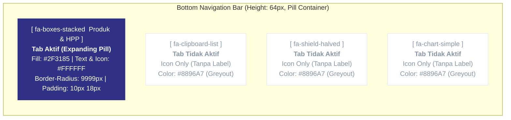

# PRODUCT REQUIREMENTS DOCUMENT (PRD)
## Aplikasi Operasional Harian UMKM: Kalkulator HPP-COPQ, Pelacak Order, Kendali Mutu & Halal

| Metadata Dokumen | Detail Spesifikasi |
| :--- | :--- |
| **Nama Produk** | **TITAN UMKM** (*Aplikasi Operasional HPP, Order, dan Mutu Usaha*) |
| **Versi Dokumen** | `1.2.0-PRD` (Revisi Lengkap: Logika Bisnis Terintegrasi, Closed-Loop COPQ, Multi-Item Order, Anti-AI Slop & PWA Lock) |
| **Fokus Utama Produk** | Aplikasi bisnis harian (*real-world production app*) untuk pemilik UMKM dengan arsitektur *Universal Sector-Preset Engine* |
| **Modul Pendamping (Terpisah)** | Mode Tugas Pelatihan (*Toggleable Homework Mode*) & Portal Monitoring Dosen Mandiri (`/monitoring`) |
| **Sistem Desain Acuan** | **TITAN Design System** (`titan-ums.web.app-DESIGN.md`) + **Strict Anti-AI Slop Guidelines** |
| **Ikonografi** | **Font Awesome 6** (`fa-solid`, `fa-regular`, `fa-brands`) — **100% Bebas Emoji/Emoticon** |
| **Strategi Infrastruktur** | **Tahap 1:** Interactive Mock Prototype (`localStorage` + Dual-Sync Persona Switcher) $\rightarrow$ **Tahap 2:** *Firebase Spark Plan* (Rp 0/Bulan) |

---

## 1. Filosofi Produk & Pemisahan Konteks (Aplikasi Real vs Modul Pelatihan)

### 1.1 Fokus Utama: Aplikasi Operasional Bisnis Nyata
Aplikasi ini dirancang sebagai **perangkat kerja harian jangka panjang bagi pemilik UMKM**, bukan sekadar alat bantu acara pelatihan sementara. Oleh karena itu:
1. **UI Utama Bersih dari Jargon Acara:** Antarmuka utama aplikasi (HPP, Order, Mutu/Halal, Rapor) menggunakan bahasa bisnis operasional yang lugas dan profesional, tanpa mencantumkan nama jadwal pelatihan, nama pemateri, atau istilah akademis yang mengganggu rutinitas harian pengguna.
2. **Mode Tugas Rumah (*Homework Mode*) Bersifat Opsional & Modular:**
   * Fitur penugasan (*checklist* misi pengisian awal) dikemas sebagai modul pendamping yang dikendalikan oleh *flag* konfigurasi (`trainingModeEnabled: boolean`, *default*: `false` pada mode reguler, dan dapat di-toggle `true` saat sesi pelatihan berlangsung).
   * Ketika `trainingModeEnabled = false`, seluruh *banner* tugas rumah hilang sepenuhnya dan aplikasi berjalan murni sebagai aplikasi bisnis UMKM.
3. **Portal Monitoring Dosen (`/monitoring`) Terpisah Sepenuhnya:**
   * Ditempatkan pada rute mandiri (`/monitoring`) yang terpisah dari *layout* utama pengguna UMKM. Pemilik UMKM yang menggunakan aplikasi sehari-hari tidak akan melihat menu dosen di navigasi mereka.

### 1.2 Empat Pilar Operasional Aplikasi Utama
1. **Katalog Produk & Kalkulator HPP-COPQ:** Menghitung modal produksi akurat (baik per unit maupun per *batch* resep), mengelola harga bahan baku tersinkronisasi, menambahkan cadangan risiko cacat (*COPQ buffer*), dan memantau realisasi risiko cacat aktual (*closed-loop warning*).
2. **Manajemen Order Multi-Item & Nota WhatsApp:** Mencatat pesanan masuk dengan banyak item produk, biaya tambahan/ongkir kustom, uang muka (DP), pelacakan tahapan pengerjaan, dan pengiriman nota/update status via WhatsApp (`wa.me`).
3. **Kendali Mutu (QC), Catatan Cacat & Kesiapan Halal:** Mencatat kejadian produk gagal/*rework* untuk menghitung kerugian riil serta memisahkan secara tegas antara **Audit Kesiapan Tempat Usaha/Halal** dan **SOP QC Produksi/Pengiriman Harian**.
4. **Rapor Usaha & Analisis Finansial-Pareto 80/20:** Menyajikan pemisahan tajam antara **Omzet Selesai vs Pipeline**, **Kas Masuk vs Piutang Nyangkut**, potongan kerugian akibat cacat (*COPQ*), laba bersih riil, dan diagram Pareto jenis masalah kualitas terbesar.

---

## 2. Pedoman Ketat Anti-AI Slop & Desain Visual (TITAN Design System)

> [!danger] **ATURAN MUTLAK ANTI-AI SLOP (WAJIB DIPATUHI AI AGENT)**
> AI Agent pengembang **DILARANG KERAS** menghasilkan pola desain generik khas AI (*AI Slop*) berikut:
> 1. **DILARANG Menggunakan Gradasi Ungu / Neon:** Jangan pernah menggunakan `linear-gradient` bernuansa ungu/violet/indigo-ke-ungu. Gunakan warna *solid flat* `#2F3185` (Primary Indigo) atau `#0F1923` (Ink) sesuai karakter *color-blocking* TITAN.
> 2. **DILARANG Membuat Accent Border Kiri pada Card:** Jangan pernah menggunakan gaya `border-left: 4px solid ...` pada komponen kartu atau *alert*. Semua kartu wajib memiliki *border* seragam `1px solid #E2E8F0` (`--color-hairline`).
> 3. **DILARANG Membuat Card di Dalam Card (*Nested Cards*):** Jangan menumpuk kotak ber-*border*/*shadow* di dalam kotak ber-*border*/*shadow* lainnya. Untuk memisahkan seksi di dalam sebuah Card, gunakan garis pemisah tipis horizontal (`1px solid #E2E8F0`) atau latar rata `#F1F5F9` tanpa *border* dan tanpa *shadow*.
> 4. **DILARANG Menggunakan Emoticon / Emoji di Seluruh UI & Teks:** Karakter seperti 📦, 📝, ✅, 📊, 💡, ⚠️, 🪑, 🍲 **harus dihapus 100%** dari kode sumber. Seluruh ikon wajib menggunakan **Font Awesome 6** (`<i className="fa-solid fa-..."></i>`).
> 5. **DILARANG Menulis Teks Bantuan Basa-Basi (*AI Filler Copy*):** Jangan menulis kalimat deskripsi panjang yang tidak menambah informasi, seperti *"Kelola seluruh produk usaha Anda dengan mudah dan cepat di halaman ini"* atau *"Tips: Pastikan Anda mengisi data dengan benar"*. Gunakan label singkat, angka langsung, dan teks fungsional.

### 2.1 Token Warna Resmi (`titan-ums.web.app-DESIGN.md`)

```css
:root {
  /* Primary & Surface (Color-Blocking Strategy) */
  --color-primary: #2F3185;        /* Brand Indigo: Active pill, primary CTA, active toggle */
  --color-primary-hover: #25276B;  /* Darker Indigo on hover/active */
  --color-on-primary: #FFFFFF;     /* Text & Font Awesome icon on primary fill */
  --color-canvas: #FFFFFF;         /* Main surface background */
  --color-neutral-1: #F1F5F9;      /* Secondary flat surface fill (page bg / table header) */
  --color-neutral-2: #CBD5E1;      /* Form input border & inactive toggle track */
  --color-hairline: #E2E8F0;       /* 1px uniform borders & flat horizontal dividers */

  /* Typography Colors */
  --color-ink: #0F1923;            /* High-contrast headings, numbers, form labels */
  --color-body: #334155;           /* Standard body text */
  --color-muted: #8896A7;          /* Inactive nav icons, secondary captions, placeholders */

  /* Measured Status & Accent Tokens */
  --color-badge-gold: #FFB800;     /* Status badge fill with #0F1923 text */
  --color-border-teal: #1CBDB3;    /* Hover border state on interactive cards/secondary buttons */
  --color-accent-dark: #1E293B;    /* Summary total block fill */
  --color-danger-subtle: #FEF2F2;  /* Flat fill untuk peringatan kebocoran/risiko tekor */
  --color-danger-text: #991B1B;    /* Teks peringatan risiko tekor */
}
```

### 2.2 Tipografi (`Inter`)
* **Font Family:** `'Inter', -apple-system, BlinkMacSystemFont, sans-serif`
* **Page Title / Nominal Utama:** `24px`, `font-weight: 800`, `line-height: 1.2`, `letter-spacing: -0.75px`, warna `#0F1923`.
* **Section Header (Uppercase):** `14px`, `font-weight: 800`, `letter-spacing: 0.7px`, `text-transform: uppercase`, warna `#0F1923`.
* **Data Value / Body Strong:** `14px`, `font-weight: 800`, `line-height: 1.43`.
* **Body Standard:** `14px`, `font-weight: 400`, `line-height: 1.6`.
* **Form Input Label (`caption-md`):** `10px`, `font-weight: 700`, `letter-spacing: 0.25px`, `text-transform: uppercase`, warna `#0F1923`, `margin-bottom: 6px`.

---

## 3. Navigasi & Aturan PWA Anti-Zoom (Mobile Lock)

### 3.1 Bottom Navigation Bar dengan Mekanisme *Expanding Pill*
Navigasi utama menggunakan **Floating / Fixed Bottom Bar** dengan perilaku **Expanding Pill**:



#### Spesifikasi Teknis *Expanding Pill Bottom Bar*:
1. **Daftar 4 Tab Utama & Ikon Font Awesome 6:**
   * Tab 1 (`hpp`): `<i class="fa-solid fa-boxes-stacked"></i>` — Label: **`Produk & HPP`**
   * Tab 2 (`orders`): `<i class="fa-solid fa-clipboard-list"></i>` — Label: **`Pesanan`**
   * Tab 3 (`quality`): `<i class="fa-solid fa-shield-halved"></i>` — Label: **`Mutu & Halal`**
   * Tab 4 (`reports`): `<i class="fa-solid fa-chart-simple"></i>` — Label: **`Rapor`**
2. **State Aktif (*Expanded Pill*):**
   * Bentuk: `border-radius: 9999px` (Pill penuh).
   * Warna Latar: `#2F3185` (`--color-primary`).
   * Warna Ikon & Teks: `#FFFFFF` (`--color-on-primary`).
   * Menampilkan **Ikon (`16px`) + Teks Label (`12px`, `font-weight: 700`, `white-space: nowrap`)** dengan jarak `gap: 8px` dan `padding: 10px 18px`.
3. **State Tidak Aktif (*Collapsed Icon-Only Greyout*):**
   * Hanya menampilkan **Ikon saja** (`18px`); elemen label disembunyikan.
   * Warna Ikon: `#8896A7` (`--color-muted` / *greyout*).
   * Warna Latar: `transparent`.
   * Area sentuh tetap minimal `44x44px`.
4. **Animasi Transisi:**
   * Menggunakan `transition: all 220ms cubic-bezier(0.4, 0, 0.2, 1)`.

### 3.2 Pencegahan Zoom Mutlak (*Strict Anti-Zoom PWA Rules*)
1. **Konfigurasi `<meta name="viewport">` di `index.html`:**
   ```html
   <meta name="viewport" content="width=device-width, initial-scale=1.0, maximum-scale=1.0, minimum-scale=1.0, user-scalable=no, viewport-fit=cover" />
   ```
2. **Aturan CSS Global Anti-Zoom & Anti-Horizontal Scroll:**
   ```css
   html, body {
     touch-action: pan-x pan-y;
     -webkit-text-size-adjust: 100%;
     -ms-text-size-adjust: 100%;
     overscroll-behavior-y: none;
     overflow-x: hidden;
     user-select: none;
     -webkit-user-select: none;
   }
   input, select, textarea {
     user-select: text;
     -webkit-user-select: text;
     font-size: 16px !important; /* Mencegah auto-zoom iOS Safari saat fokus input */
   }
   ```
3. **Event Listener Pencegahan Gesture Zoom Tambahan (iOS Safari Fallback):**
   Mencegah event `gesturestart` dan `dblclick` zoom pada elemen jendela aplikasi.

---

## 4. Arsitektur Universal & Matriks Preset Sektor

Pengguna dapat memilih sektor usahanya saat pendaftaran atau mengubahnya kapan saja di Pengaturan Profil Usaha tanpa menghapus data produk yang telah diinput sebelumnya.

| Properti | `mebel` (Mebel & Kayu) | `fnb` (Kuliner & Pangan) | `fashion` (Konveksi & Tekstil) | `custom` (Usaha Umum) |
| :--- | :--- | :--- | :--- | :--- |
| **Font Awesome Icon** | `fa-solid fa-couch` | `fa-solid fa-utensils` | `fa-solid fa-shirt` | `fa-solid fa-briefcase` |
| **Default Calc Mode** | `unit_based` | `batch_based` | `unit_based` | `unit_based` |
| **Label Produk** | Model Mebel | Menu / Produk | Model / Artikel | Nama Produk |
| **Label Bahan Utama** | Bahan Kayu / Papan | Bahan Baku Resep | Kain Utama | Bahan Baku Utama |
| **Label Bahan Penolong** | Finishing & Hardware | Kemasan & Bumbu Pelengkap | Benang, Aksesoris & Kemasan | Bahan Penolong & Kemasan |
| **Label Tenaga Kerja** | Upah Tukang | Upah Produksi / Masak | Upah Potong & Jahit | Biaya Tenaga Kerja |
| **Tahapan Order (`orderStages`)** | 1. `Bahan Baku`<br>2. `Konstruksi`<br>3. `Finishing`<br>4. `Siap Kirim` | 1. `Persiapan`<br>2. `Produksi`<br>3. `Pengemasan`<br>4. `Siap Kirim` | 1. `Potong Pola`<br>2. `Penjahitan`<br>3. `Finishing`<br>4. `Siap Kirim` | 1. `Persiapan`<br>2. `Pengerjaan`<br>3. `Pemeriksaan`<br>4. `Selesai` |
| **Kategori Cacat Populer** | • Kayu retak / melengkung<br>• Ukuran tidak presisi<br>• Finishing belang / kasar<br>• Sambungan renggang<br>• Cacat pengiriman | • Adonan gagal / gosong<br>• Rasa tidak konsisten<br>• Kemasan bocor / rusak<br>• Produk basi / tengik<br>• Rusak saat pengiriman | • Ukuran meleset<br>• Jahitan tidak rapi<br>• Kain cacat / noda<br>• Aksesoris lepas/macet | • Bahan baku cacat<br>• Spesifikasi meleset<br>• Cacat fungsi / fisik<br>• Kemasan rusak |

> **Ekstensi Sektor:** Fitur khusus sektor `mebel` (Kalkulator Kubikasi Kayu, Termin Pembayaran 3 Tahap, Surat Penawaran Harga, Upah Borongan & Kasbon Tukang) dispesifikasikan di dokumen terpisah [`PRD_Modul_Mebel_Furniture.md`](./PRD_Modul_Mebel_Furniture.md). Fitur tersebut diaktifkan lewat flag `SectorDefinition.features`, bukan pengecekan sektor yang tersebar di kode.

---

## 5. Spesifikasi Fungsional 4 Menu Utama (Logika Bisnis Terintegrasi)

### 5.1 Menu 1: Produk & HPP (`fa-solid fa-boxes-stacked`)

#### A. Perbaikan Logika Kalkulasi: Dua Mesin yang Bersih dari *Double-Counting*
1. **Mode `batch_based` (Kuliner / FnB):**
   * Menghitung total seluruh biaya bahan resep, kemasan, upah, dan overhead untuk **1 kali masak/adonan**.
   * Membagi total biaya tersebut dengan **`Jumlah Porsi/Pcs Layak Jual per Batch`** ($N \ge 1$).
   * *Catatan Logika:* **Tidak ada input susut per bahan** karena susut adonan sudah otomatis tercermin dari jumlah porsi matang layak jual.
2. **Mode `unit_based` (Mebel / Kriya / Konveksi):**
   * Menghitung biaya untuk menghasilkan **1 unit produk**.
   * Disediakan kolom opsional **`Susut / Rendemen (%)`** khusus pada bahan mentah utama (misal kayu papan terbuang 15% saat diserut).
   $$\text{Biaya Bahan Mentah Efektif} = \frac{\text{Qty} \times \text{Harga Satuan}}{1 - (\text{Susut} / 100)}$$

#### B. Rumus HPP, Cadangan Risiko Cacat, dan Rekomendasi Harga Jual
1. **HPP Dasar per Unit (`baseHpp`):**
   $$\text{HPP Dasar per Unit} = \frac{\text{Total Biaya Bahan} + \text{Penolong} + \text{Tenaga Kerja} + \text{Overhead}}{\text{OutputQty}}$$
2. **Cadangan Risiko Cacat (*COPQ Buffer*) — Sebagai Pengaman Harga Jual:**
   Pengguna menginput persentase cadangan risiko (`defectRiskPercent`, misal `5%`).
   $$\text{Beban Cadangan Cacat per Unit} = \text{HPP Dasar} \times \left(\frac{\text{defectRiskPercent}}{100}\right)$$
   $$\text{HPP Riil Aman per Unit} = \text{HPP Dasar} + \text{Beban Cadangan Cacat per Unit}$$
3. **Penetapan Harga Jual & Margin Riil:**
   $$\text{Laba Bersih Aman per Unit} = \text{Harga Jual Aktual} - \text{HPP Riil Aman}$$
   $$\text{Margin Laba Bersih (\%)} = \left(\frac{\text{Laba Bersih Aman per Unit}}{\text{Harga Jual Aktual}}\right) \times 100\%$$

#### C. Fitur Kunci: *Closed-Loop Feedback Warning* (Umpan Balik Risiko Aktual)
* Sistem menghitung rata-rata rasio kerugian cacat riil produk tersebut dari riwayat Menu 3:
  $$\text{Rasio Cacat Aktual (\%)} = \frac{\text{Total Kerugian COPQ Produk Tersebut}}{\text{Total Omzet Nilai Produk Tersebut}} \times 100\%$$
* Jika $\text{Rasio Cacat Aktual} > \text{defectRiskPercent}$ yang disetel di katalog, kartu produk menampilkan kotak informasi datar (`#FEF2F2`, teks `#991B1B`):
  > `<i class="fa-solid fa-triangle-exclamation"></i> Realisasi Cacat [X]% > Cadangan [Y]%. Margin terancam tekor. Disarankan menaikkan cadangan risiko atau membenahi kualitas produksi.`

#### D. Fitur Sinkronisasi Harga Bahan Baku
* Saat pengguna memperbarui harga suatu bahan baku (misal: *Kayu Jati* atau *Minyak Goreng*), sistem menampilkan opsi *checkbox*:
  `[v] Terapkan harga baru ini ke semua produk lain yang menggunakan bahan yang sama`.

---

### 5.2 Menu 2: Pesanan (`fa-solid fa-clipboard-list`)

#### A. Perbaikan Logika: Pesanan Multi-Item & Biaya Kustom/Ongkir
Untuk mengakomodasi pesanan riil di lapangan, struktur pesanan dirombak menjadi:
1. **Dukungan Multi-Item Produk:**
   * Pengguna dapat menambahkan lebih dari 1 produk dalam 1 nota pesanan (misal: *1 Meja Makan Jati + 4 Kursi Makan* atau *10 pak Kerupuk Tengiri + 5 botol Sambal*).
   * Kuantitas dan harga satuan dapat disesuaikan per baris item.
2. **Kolom Biaya Tambahan Kustom / Ongkir (`customFee`):**
   * Input opsional untuk biaya poles khusus, paking kayu ekspor, atau ongkos kirim ekspedisi.
3. **Perhitungan Finansial Nota:**
   $$\text{Total Nilai Nota} = \sum (\text{Qty}_i \times \text{Harga Satuan}_i) + \text{Biaya Tambahan / Ongkir}$$
   $$\text{Sisa Piutang Pelanggan} = \max(0, \text{Total Nilai Nota} - \text{Total DP Masuk})$$
   $$\text{HPP Total Pesanan} = \sum (\text{Qty}_i \times \text{HPP Dasar}_i)$$
4. **Status Pengerjaan & Pembayaran:**
   * Status Tahapan: `Persiapan`, `Pengerjaan`, `Finishing`, `Siap Kirim`, `Selesai`.
   * Status Pembayaran: `Belum DP`, `DP Sebagian`, `Lunas`.
   * Status Khusus: `Dibatalkan` (pesanan batal tidak dihitung ke omzet atau laba di Rapor).

#### B. Integrasi Pintas ke Menu Mutu & WhatsApp
* **Pintas Catat Cacat dari Pesanan:** Pada kartu pesanan yang sedang diproses, terdapat tombol `<i class="fa-solid fa-bug"></i> Catat Cacat` yang otomatis membuka form Menu 3 dengan nomor order dan produk terisi otomatis.
* **Generator Pesanan WhatsApp (`wa.me`):** Menyediakan 3 format pesan instan:
  1. *Konfirmasi Nota & Tanda Terima DP*
  2. *Laporan Kemajuan Pengerjaan Produk*
  3. *Pemberitahuan Pesanan Siap & Tagihan Pelunasan*

---

### 5.3 Menu 3: Mutu & Halal (`fa-solid fa-shield-halved`)

Menu ini memisahkan secara tegas antara **Pencatatan Insiden Cacat (COPQ)** dengan **Dua Level Pemeriksaan Mutu/Halal**.

#### Sub-Tab 1: Catatan Cacat & Rework (`COPQ Log`)
* **Input Kejadian:** Pilih Produk, Order terkait (opsional), Tanggal, dan Jenis Cacat.
* **Klasifikasi Akar Penyebab (*Fishbone 4M+1E*):** `Bahan Baku`, `Alat/Mesin`, `Metode Kerja`, `Tenaga Kerja`, `Lingkungan`.
* **Catatan Solusi Perbaikan (*Action Plan*):** 1 baris tindakan korektif.
* **Kalkulasi Biaya Kerugian Riil (*Actual COPQ*):**
  $$\text{Kerugian Bahan Rusak Total} = \text{Unit Rusak Total} \times \text{HPP Dasar}$$
  $$\text{Total Kerugian COPQ} = \text{Kerugian Bahan Rusak} + \text{Biaya Tambahan Rework (Bahan & Upah)} + \text{Potongan Komplain}$$

#### Sub-Tab 2: Pemisahan Dua Level Checklist Mutu & Halal
1. **Level A: Audit Kesiapan Fasilitas Usaha & Titik Kritis Halal (Audit Berkala Usaha):**
   * *Mebel & Barang Gunaan:* Verifikasi kuas cat bebas bulu babi (*bristle check*), pelarut dan perekat bebas unsur hewani haram, standar *food-grade coating* untuk peralatan makan kayu (*woodenware*), dan kebersihan bengkel 5R dari najis kotoran hewan.
   * *FnB & Kuliner:* Keabsahan sertifikat Halal seluruh bahan baku/bumbu, pemisahan alat cuci dari najis, higienitas dapur dan pekerja, serta kelengkapan dokumen matriks bahan *Self-Declare* BPJPH.
   * *Indikator:* Menampilkan skor kesiapan tempat usaha (misal: `Skor Kesiapan Halal: 85%`).
2. **Level B: Standar Operasional Prosedur (SOP) QC Harian Sebelum Kirim:**
   * *Mebel:* Pengecekan kekeringan kayu (*MC*), kerataan siku konstruksi, kehalusan amplas, keseragaman warna cat, dan pelindung sudut barang sebelum ekspedisi.
   * *FnB:* Penimbangan takaran baku, uji organoleptik (rasa/tekstur) per *batch*, kerapatan segel kemasan, dan kode kedaluwarsa.

---

### 5.4 Menu 4: Rapor Usaha (`fa-solid fa-chart-simple`)

#### A. Filter Periode Finansial
Disediakan tombol pemilih periode: `Bulan Ini`, `Bulan Lalu`, `Semua Waktu`.

#### B. Pemisahan Tajam Indikator Keuangan (Arus Kas vs Akuntansi)
1. **Omzet Pesanan Selesai:** Total nilai pesanan yang sudah berstatus `Selesai`.
2. **Nilai Pesanan Sedang Diproses (*Pipeline*):** Total nilai pesanan aktif yang belum selesai dikerjakan.
3. **Kas Masuk Terkumpul:** Total uang riil yang sudah diterima di tangan pemilik (DP + Pelunasan dari seluruh pesanan non-batal).
4. **Sisa Piutang Pelanggan:** Total uang yang belum dilunasi oleh pelanggan.
5. **Laba Kotor Dasar:** $\text{Omzet Pesanan Selesai} - \text{Total HPP Dasar Pesanan Selesai}$.
6. **Total Kebocoran Biaya Cacat (Actual COPQ):** Total kerugian riil dari catatan Menu 3 pada periode tersebut.
7. **Laba Bersih Riil Usaha:**
   $$\text{Laba Bersih Riil} = \text{Laba Kotor Dasar} - \text{Total Kebocoran Biaya Cacat (COPQ)}$$
   *(Ditampilkan mencolok dengan persentase margin laba bersih riil)*

#### C. Diagram Pareto Masalah Kualitas (80/20)
* Mengelompokkan seluruh catatan cacat berdasarkan jenis masalah dan mengurutkannya dari nominal rupiah terbesar ke terkecil.
* Menampilkan diagram batang horizontal satu lapis dengan pembeda warna:
  * Batang `#2F3185` (Primary Indigo) untuk masalah dalam zona 80% pertama (*Vital Few*).
  * Batang `#94A3B8` (Slate Light) untuk masalah dalam zona 20% sisanya (*Trivial Many*).
* Menampilkan rekomendasi fokus perbaikan berbasis faktor *Fishbone* yang paling banyak menyebabkan kebocoran biaya.

---

## 6. Spesifikasi Modul Pelatihan Terpisah & Portal Dosen

### 6.1 Mode Tugas Pelatihan (`trainingModeEnabled` Flag)
* Bersifat opsional dan dapat dinonaktifkan (`true`/`false`).
* Jika `false`, tampilan antarmuka 100% bersih menjadi aplikasi operasional UMKM reguler.
* Jika `true`, menampilkan *bar* kompak yang memantau 3 tugas:
  1. Minimal 2 Produk HPP
  2. Minimal 1 Pesanan Aktif
  3. Minimal 1 Catatan Cacat

### 6.2 Portal Monitoring Dosen Mandiri (`/monitoring`)
Ditempatkan pada rute terpisah berproteksi PIN (`2026`) untuk keperluan Sesi 5 Jumat pagi serta pelaporan riset/PkM dosen:
1. **Statistik Agregat Kelas Real-Time:** Total UMKM per sektor, persentase penyelesaian tugas, rata-rata kebocoran biaya COPQ kelas, dan Pareto masalah cacat paling dominan di Jepara.
2. **Mode Bedah Kasus (*Hot-Seat Modal*):** Menampilkan struktur HPP dan catatan cacat peserta terpilih ke layar proyektor, dilengkapi tombol *slider* koreksi margin langsung oleh dosen dan *toggle* penyamaran nama UMKM (Mode Anonim).
3. **Ekspor Data CSV (1-Klik):** Mengunduh seluruh rekapitulasi data dalam format `.csv` rapi untuk lampiran laporan pengabdian masyarakat.

---

## 7. Sinkronisasi Data Tahap Mock (Dual-Sync Architecture)

Untuk menjamin kelancaran pengujian prototipe sebelum ke Firebase produksi:
1. **Drawer / Switcher Penguji di Pojok Layar:**
   * Pilihan Persona: `UMKM Mebel`, `UMKM FnB`, `UMKM Kriya`, atau `Data Kosong`.
   * Toggle `Homework Mode: ON / OFF`.
   * Tombol Buka `Portal Dosen /monitoring`.
   * Tombol `Reset Data Simulasi`.
2. **Live Dual-Sync ke Portal Dosen:**
   * Setiap kali penguji mengedit produk, menambah order, atau mencatat cacat pada persona aktif di tampilan UMKM, perubahan tersebut **langsung terinjeksi secara live** ke baris teratas daftar peserta di portal `/monitoring`.
   * Angka rekapitulasi kelas, grafik Pareto agregat, dan simulasi *Hot-Seat* dosen otomatis terbarui tanpa perlu memuat ulang halaman (*real-time reactive sync*).

---

## 8. Lampiran Teknis: Skema Data TypeScript (`interfaces.ts`) & Mesin Kalkulasi (`calculations.ts`)

### 8.1 Skema Data Utama (`src/types/titan.ts`)

```typescript
// ==========================================
// 1. TIPE KONFIGURASI & SEKTOR PRESET
// ==========================================
export type SectorId = 'mebel' | 'fnb' | 'fashion' | 'custom';
export type CalcMode = 'unit_based' | 'batch_based';
export type OrderStage = 'Persiapan' | 'Pengerjaan' | 'Finishing' | 'Siap Kirim' | 'Selesai' | 'Dibatalkan';
export type PaymentStatus = 'Belum DP' | 'DP Sebagian' | 'Lunas';
export type FishboneCategory = 'Bahan Baku' | 'Alat/Mesin' | 'Metode Kerja' | 'Tenaga Kerja' | 'Lingkungan';

export interface BusinessProfile {
  id: string;
  name: string;
  ownerName: string;
  phone: string;
  sector: SectorId;
  trainingModeEnabled: boolean; // Default: false untuk aplikasi harian, true saat pelatihan
  createdAt: string;
  updatedAt: string;
}

// ==========================================
// 2. MENU 1: KATALOG PRODUK & HPP-COPQ
// ==========================================
export interface MaterialItem {
  id: string;
  name: string;               // Contoh: "Kayu Jati Grade A" atau "Tepung Tengiri"
  normalizedKey: string;      // Auto-generated: "kayu_jati_grade_a__m3" (untuk sinkronisasi harga)
  category: 'main' | 'auxiliary';
  qty: number;
  unit: string;               // Contoh: "m3", "lembar", "kg", "pcs"
  unitPrice: number;
  wastagePercent: number;     // 0-99%. Aktif hanya pada mode 'unit_based' & category 'main'
}

export interface Product {
  id: string;
  name: string;
  calcMode: CalcMode;
  outputQty: number;          // Wajib 1 jika 'unit_based', >= 1 jika 'batch_based' (porsi layak jual)
  materials: MaterialItem[];
  laborCost: number;          // Upah per unit (unit_based) atau per batch (batch_based)
  overheadCost: number;       // Listrik, gas, penyusutan alat per unit/batch
  defectRiskPercent: number;  // Cadangan risiko cacat (COPQ Buffer), misal: 5 (%)
  sellingPrice: number;       // Harga jual aktual per unit/porsi yang ditetapkan pemilik
  
  // Computed Values (Disimpan untuk mempercepat pembacaan di Portal Monitoring)
  baseHpp: number;            // HPP Dasar per unit (sebelum buffer)
  copqBufferAmount: number;   // Nominal rupiah cadangan cacat per unit
  safeHpp: number;            // HPP Riil Aman (baseHpp + copqBufferAmount)
  netProfitPerUnit: number;   // sellingPrice - safeHpp
  netMarginPercent: number;   // (netProfitPerUnit / sellingPrice) * 100
  updatedAt: string;
}

// ==========================================
// 3. MENU 2: PESANAN MULTI-ITEM (DENGAN SNAPSHOT)
// ==========================================
export interface OrderItem {
  id: string;
  productId: string;
  productNameSnapshot: string; // Dikunci saat order dibuat
  qty: number;
  unitPriceSnapshot: number;   // Harga jual satuan saat transaksi (bisa dinego/diubah per order)
  baseHppSnapshot: number;     // WAJIB DIKUNCI: Mencegah mutasi laba masa lalu saat harga bahan naik
}

export interface Order {
  id: string;
  orderNumber: string;         // Contoh: "ORD-202611-001"
  customerName: string;
  customerPhone: string;       // Format: "62812..." untuk integrasi wa.me
  items: OrderItem[];
  customFee: number;           // Ongkir / Paking Ekspor (Pass-through cost, bukan laba produk)
  customFeeNote?: string;      // Contoh: "Ongkir Truk Ekspedisi Jakarta"
  dpAmount: number;            // Total uang yang sudah dibayarkan pelanggan (DP + Cicilan/Pelunasan)
  stage: OrderStage;
  paymentStatus: PaymentStatus;
  createdAt: string;           // ISO Date saat pesanan masuk
  completedAt?: string;        // ISO Date saat status diubah menjadi 'Selesai' (Acuan Laba Rugi)
  dueDate: string;             // Target selesai/kirim
}

// ==========================================
// 4. MENU 3: KENDALI MUTU (COPQ) & CHECKLIST HALAL/QC
// ==========================================
export interface DefectLog {
  id: string;
  productId: string;
  productNameSnapshot: string;
  orderId?: string;            // Opsional: terhubung jika dicatat dari pintasan Kartu Pesanan
  orderNumberSnapshot?: string;
  date: string;                // ISO Date kejadian cacat
  defectType: string;          // Contoh: "Kayu retak / melengkung" atau "Adonan gagal / gosong"
  fishboneFactor: FishboneCategory;
  actionPlan: string;          // 1 baris tindakan korektif
  
  // Komponen Perhitungan Actual COPQ
  scrappedUnits: number;       // Jumlah unit rusak total (tidak bisa dijual)
  baseHppSnapshot: number;     // HPP dasar produk saat cacat terjadi
  reworkCost: number;          // Biaya tambahan bahan + tukang untuk perbaikan
  complaintDiscount: number;   // Potongan harga/ganti rugi ke pelanggan akibat komplain
  totalCopqLoss: number;       // (scrappedUnits * baseHppSnapshot) + reworkCost + complaintDiscount
}

export interface ChecklistItem {
  id: string;
  level: 'halal_facility' | 'daily_qc'; // Level A (Audit Berkala Halal/5R) vs Level B (SOP QC Harian)
  sector: SectorId;
  title: string;
  isChecked: boolean;
  updatedAt: string;
}
```

### 8.2 Mesin Kalkulasi Akurat & Bebas-Bug (`src/utils/calculations.ts`)

```typescript
import { Product, MaterialItem, Order, DefectLog, FishboneCategory } from '../types/titan';

/**
 * 1. KALKULASI HPP PRODUK (MENU 1)
 * Menjamin pemisahan bersih antara mode 'unit_based' (dengan susut bahan utama)
 * dan 'batch_based' (tanpa susut per bahan untuk menghindari double-counting).
 */
export function calculateProductHpp(
  calcMode: 'unit_based' | 'batch_based',
  outputQty: number,
  materials: MaterialItem[],
  laborCost: number,
  overheadCost: number,
  defectRiskPercent: number,
  sellingPrice: number
) {
  const validOutputQty = calcMode === 'unit_based' ? 1 : Math.max(1, outputQty);

  const totalMaterialCost = materials.reduce((sum, item) => {
    const rawCost = item.qty * item.unitPrice;

    // Susut bahan mentah HANYA berlaku pada mode unit_based dan kategori bahan utama ('main')
    if (calcMode === 'unit_based' && item.category === 'main' && item.wastagePercent > 0) {
      const safeWastage = Math.min(95, Math.max(0, item.wastagePercent)); // Cegah division by zero
      const effectiveCost = rawCost / (1 - safeWastage / 100);
      return sum + effectiveCost;
    }

    return sum + rawCost;
  }, 0);

  const totalProductionCost = totalMaterialCost + laborCost + overheadCost;
  const baseHpp = Math.round(totalProductionCost / validOutputQty);
  const copqBufferAmount = Math.round(baseHpp * (Math.max(0, defectRiskPercent) / 100));
  const safeHpp = baseHpp + copqBufferAmount;
  const netProfitPerUnit = sellingPrice - safeHpp;
  const netMarginPercent = sellingPrice > 0 
    ? Number(((netProfitPerUnit / sellingPrice) * 100).toFixed(1)) 
    : 0;

  return {
    baseHpp,
    copqBufferAmount,
    safeHpp,
    netProfitPerUnit,
    netMarginPercent,
  };
}

/**
 * 2. CLOSED-LOOP FEEDBACK WARNING (MENU 1.C)
 * Membandingkan Total Kerugian COPQ Produk terhadap Eksposur Biaya Produksi (HPP Dasar)
 * agar satuannya apel-ke-apel dengan defectRiskPercent (yang berbasis HPP Dasar).
 */
export function evaluateProductCopqWarning(
  product: Product,
  orders: Order[],
  defects: DefectLog[]
) {
  const productDefects = defects.filter((d) => d.productId === product.id);
  const totalProductCopqLoss = productDefects.reduce((sum, d) => sum + d.totalCopqLoss, 0);

  if (totalProductCopqLoss === 0) {
    return { isWarning: false, actualDefectRatio: 0, totalProductCopqLoss: 0 };
  }

  // Hitung total unit produk ini yang pernah dipesan (non-batal)
  let totalOrderedUnits = 0;
  let totalHistoricalHppExposure = 0;

  orders
    .filter((o) => o.stage !== 'Dibatalkan')
    .forEach((order) => {
      order.items.forEach((item) => {
        if (item.productId === product.id) {
          totalOrderedUnits += item.qty;
          totalHistoricalHppExposure += item.qty * item.baseHppSnapshot;
        }
      });
    });

  // Fallback baseline: Jika produk baru dicatat cacatnya sebelum ada order masuk,
  // gunakan baseline minimal 10 unit/porsi produksi agar rasio tetap rasional.
  const baselineHppExposure = Math.max(
    totalHistoricalHppExposure,
    product.baseHpp * Math.max(10, product.outputQty)
  );

  const actualDefectRatio =
    baselineHppExposure > 0
      ? Number(((totalProductCopqLoss / baselineHppExposure) * 100).toFixed(1))
      : 0;

  return {
    isWarning: actualDefectRatio > product.defectRiskPercent,
    actualDefectRatio,
    configuredBuffer: product.defectRiskPercent,
    totalProductCopqLoss,
  };
}

/**
 * 3. KALKULASI NOTA PESANAN MULTI-ITEM (MENU 2)
 * Memisahkan subtotal produk dari customFee (ongkir/paking) agar laba tidak terdistorsi.
 */
export function calculateOrderFinancials(order: Order) {
  const itemsSubtotal = order.items.reduce(
    (sum, item) => sum + item.qty * item.unitPriceSnapshot,
    0
  );
  const totalOrderHpp = order.items.reduce(
    (sum, item) => sum + item.qty * item.baseHppSnapshot,
    0
  );
  const totalInvoiceAmount = itemsSubtotal + (order.customFee || 0);
  const remainingReceivable = Math.max(0, totalInvoiceAmount - order.dpAmount);

  // Otomatisasi status pembayaran
  let paymentStatus: 'Belum DP' | 'DP Sebagian' | 'Lunas' = 'Belum DP';
  if (order.dpAmount >= totalInvoiceAmount && totalInvoiceAmount > 0) {
    paymentStatus = 'Lunas';
  } else if (order.dpAmount > 0) {
    paymentStatus = 'DP Sebagian';
  }

  return {
    itemsSubtotal,        // Nilai murni penjualan produk (acuan Laba Kotor)
    customFee: order.customFee || 0,
    totalInvoiceAmount,   // Total tagihan di nota WA (Produk + Ongkir)
    totalOrderHpp,        // Total HPP Dasar yang terkunci pada nota ini
    remainingReceivable,  // Sisa piutang pelanggan
    paymentStatus,
  };
}

/**
 * 4. RAPOR USAHA & PARETO 80/20 (MENU 4)
 * Memisahkan Arus Kas vs Akuntansi dan mengklasifikasikan Vital Few (80%) vs Trivial Many (20%).
 */
export function generateFinancialReport(orders: Order[], defects: DefectLog[]) {
  const activeOrders = orders.filter((o) => o.stage !== 'Dibatalkan');
  const completedOrders = activeOrders.filter((o) => o.stage === 'Selesai');
  const pipelineOrders = activeOrders.filter((o) => o.stage !== 'Selesai');

  // 1. Omzet Produk Selesai (Murni penjualan produk, tanpa ongkir pass-through)
  const completedProductRevenue = completedOrders.reduce((sum, o) => {
    const { itemsSubtotal } = calculateOrderFinancials(o);
    return sum + itemsSubtotal;
  }, 0);

  // 2. Total Nilai Nota Selesai (Termasuk ongkir, untuk informasi tagihan penuh)
  const completedGrossInvoice = completedOrders.reduce((sum, o) => {
    const { totalInvoiceAmount } = calculateOrderFinancials(o);
    return sum + totalInvoiceAmount;
  }, 0);

  // 3. Nilai Pesanan Sedang Diproses (Pipeline)
  const pipelineValue = pipelineOrders.reduce((sum, o) => {
    const { totalInvoiceAmount } = calculateOrderFinancials(o);
    return sum + totalInvoiceAmount;
  }, 0);

  // 4. Kas Masuk Terkumpul & Sisa Piutang (Dari seluruh pesanan aktif non-batal)
  const cashCollected = activeOrders.reduce((sum, o) => sum + o.dpAmount, 0);
  const totalReceivables = activeOrders.reduce((sum, o) => {
    const { remainingReceivable } = calculateOrderFinancials(o);
    return sum + remainingReceivable;
  }, 0);

  // 5. Laba Kotor Dasar (Hanya dari produk selesai dikurangi HPP snapshot-nya)
  const completedHppTotal = completedOrders.reduce((sum, o) => {
    const { totalOrderHpp } = calculateOrderFinancials(o);
    return sum + totalOrderHpp;
  }, 0);
  const baseGrossProfit = completedProductRevenue - completedHppTotal;

  // 6. Total Kebocoran Biaya Cacat (Actual COPQ) & Laba Bersih Riil
  const totalActualCopq = defects.reduce((sum, d) => sum + d.totalCopqLoss, 0);
  const realNetProfit = baseGrossProfit - totalActualCopq;
  const realNetMarginPercent =
    completedProductRevenue > 0
      ? Number(((realNetProfit / completedProductRevenue) * 100).toFixed(1))
      : 0;

  // 7. Analisis Diagram Pareto 80/20 Berdasarkan Jenis Cacat
  const defectMap = new Map<string, { amount: number; count: number; topFactor: FishboneCategory }>();
  defects.forEach((d) => {
    const current = defectMap.get(d.defectType) || { amount: 0, count: 0, topFactor: d.fishboneFactor };
    defectMap.set(d.defectType, {
      amount: current.amount + d.totalCopqLoss,
      count: current.count + 1,
      topFactor: d.fishboneFactor,
    });
  });

  const sortedDefects = Array.from(defectMap.entries())
    .map(([defectType, data]) => ({ defectType, ...data }))
    .sort((a, b) => b.amount - a.amount);

  let cumulativeAmount = 0;
  const paretoItems = sortedDefects.map((item, index) => {
    const previousCumulativePercent =
      totalActualCopq > 0 ? (cumulativeAmount / totalActualCopq) * 100 : 0;
    cumulativeAmount += item.amount;
    const cumulativePercent =
      totalActualCopq > 0 ? Number(((cumulativeAmount / totalActualCopq) * 100).toFixed(1)) : 0;
    const sharePercent =
      totalActualCopq > 0 ? Number(((item.amount / totalActualCopq) * 100).toFixed(1)) : 0;

    // Masuk zona Vital Few (80% pertama) jika item pertama ATAU akumulasi sebelumnya masih < 80%
    const isVitalFew = index === 0 || previousCumulativePercent < 80;

    return {
      ...item,
      sharePercent,
      cumulativePercent,
      isVitalFew, // true = #2F3185 (Primary Indigo), false = #94A3B8 (Slate Light)
    };
  });

  return {
    completedProductRevenue,
    completedGrossInvoice,
    pipelineValue,
    cashCollected,
    totalReceivables,
    completedHppTotal,
    baseGrossProfit,
    totalActualCopq,
    realNetProfit,
    realNetMarginPercent,
    paretoItems,
  };
}
```

### 8.3 Helper Sinkronisasi Bahan Baku & Live Dual-Sync (`src/utils/syncEngine.ts`)

```typescript
import { Product } from '../types/titan';

/**
 * Normalisasi kunci bahan baku (Nama + Satuan) agar sinkronisasi harga akurat
 * Contoh: "Kayu Jati " + "M3" -> "kayu_jati__m3"
 */
export function createMaterialKey(name: string, unit: string): string {
  const cleanName = name.trim().toLowerCase().replace(/\s+/g, '_');
  const cleanUnit = unit.trim().toLowerCase();
  return `${cleanName}__${cleanUnit}`;
}

/**
 * Memperbarui harga bahan baku yang sama di seluruh katalog produk (Menu 1.D)
 * dan otomatis menghitung ulang HPP masing-masing produk yang terdampak.
 */
export function syncMaterialPriceAcrossProducts(
  products: Product[],
  targetMaterialKey: string,
  newUnitPrice: number,
  recalculateFn: (p: Product) => Product
): { updatedProducts: Product[]; affectedCount: number } {
  let affectedCount = 0;

  const updatedProducts = products.map((product) => {
    let isModified = false;
    const updatedMaterials = product.materials.map((mat) => {
      if (mat.normalizedKey === targetMaterialKey && mat.unitPrice !== newUnitPrice) {
        isModified = true;
        return { ...mat, unitPrice: newUnitPrice };
      }
      return mat;
    });

    if (isModified) {
      affectedCount++;
      return recalculateFn({ ...product, materials: updatedMaterials });
    }
    return product;
  });

  return { updatedProducts, affectedCount };
}

/**
 * LIVE DUAL-SYNC ENGINE (Tahap 1: Mock Prototype Lintas Tab Browser)
 * Memastikan saat UMKM/Penguji mengubah data di Tab Utama (/),
 * Portal Monitoring Dosen (/monitoring) di Tab Proyektor langsung terbarui secara real-time.
 */
const SYNC_CHANNEL_NAME = 'titan_umkm_dual_sync_v1';
const STORAGE_KEY = 'titan_umkm_active_state';

export function broadcastStateUpdate(payload: unknown) {
  // 1. Simpan ke localStorage (memicu 'storage' event di tab lain)
  localStorage.setItem(STORAGE_KEY, JSON.stringify(payload));

  // 2. Broadcast instan via BroadcastChannel API
  if (typeof window !== 'undefined' && 'BroadcastChannel' in window) {
    const channel = new BroadcastChannel(SYNC_CHANNEL_NAME);
    channel.postMessage({ type: 'STATE_UPDATED', payload, timestamp: Date.now() });
    channel.close();
  }
}

export function subscribeToDualSync(onUpdate: (data: any) => void): () => void {
  // Listener 1: BroadcastChannel API (Modern & Cepat)
  let channel: BroadcastChannel | null = null;
  if (typeof window !== 'undefined' && 'BroadcastChannel' in window) {
    channel = new BroadcastChannel(SYNC_CHANNEL_NAME);
    channel.onmessage = (event) => {
      if (event.data?.type === 'STATE_UPDATED') {
        onUpdate(event.data.payload);
      }
    };
  }

  // Listener 2: Fallback window 'storage' event
  const handleStorageEvent = (e: StorageEvent) => {
    if (e.key === STORAGE_KEY && e.newValue) {
      try {
        onUpdate(JSON.parse(e.newValue));
      } catch (err) {
        console.error('Gagal memproses sinkronisasi state TITAN:', err);
      }
    }
  };

  window.addEventListener('storage', handleStorageEvent);

  // Cleanup function untuk React useEffect
  return () => {
    if (channel) channel.close();
    window.removeEventListener('storage', handleStorageEvent);
  };
}
```

### 8.4 Rangkuman Nilai Solusi Teknis pada Lampiran 8:
1. **Immutability Laba Historis:** `OrderItem` menyimpan `baseHppSnapshot` dan `unitPriceSnapshot`, sehingga fitur Sinkronisasi Harga Bahan Baku (`syncMaterialPriceAcrossProducts`) hanya mengubah HPP katalog saat ini dan tidak merusak laporan laba rugi pesanan bulan lalu.
2. **Pemisahan Ongkir (`customFee`) dari Laba Kotor:** Di `calculateOrderFinancials` dan `generateFinancialReport`, ongkir tetap masuk ke `totalInvoiceAmount` (untuk tagihan nota WA dan pelacakan piutang), tetapi dikeluarkan dari `completedProductRevenue` saat menghitung `baseGrossProfit`.
3. **Akurasi Closed-Loop Warning:** `evaluateProductCopqWarning` membandingkan total kerugian cacat produk terhadap eksposur HPP produksi produk tersebut (dengan *fallback baseline* 10 unit untuk produk baru), sehingga persentase peringatannya presisi terhadap `defectRiskPercent`.
4. **Klasifikasi Visual Pareto 80/20:** `generateFinancialReport` langsung menghasilkan boolean `isVitalFew` untuk setiap jenis cacat sehingga komponen UI cukup merender warna `#2F3185` jika `true` dan `#94A3B8` jika `false` sesuai aturan TITAN Design System.
