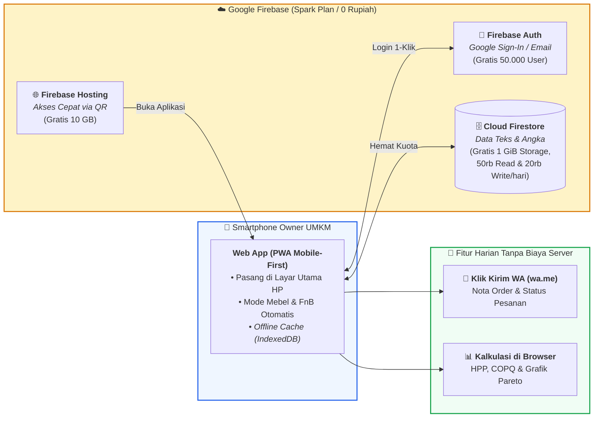

# RANCANGAN AGENDA DAN MATERI KEGIATAN: PELATIHAN & KONSULTASI TEKNIS UMKM KABUPATEN JEPARA

> [!abstract] **Ringkasan Eksekutif Kegiatan**
> **Peningkatan Kualitas Produk, Efisiensi HPP, Sistem Informasi Usaha, dan Kesiapan Halal melalui Pendekatan Teknik Industri bagi UMKM Mebel dan Kuliner (FnB) Kabupaten Jepara**
> 
> 📅 **Rangkaian Waktu Pelaksanaan:**  
> * **Rabu, 11 November 2026:** Sesi Materi & Sosialisasi oleh **BPOM** *(Mengawali rangkaian kegiatan)*  
> * **Kamis – Jumat, 12 – 13 November 2026 (2 Hari Inti Tim Dosen):** Pelatihan, Praktik Sistem, & Konsultasi Teknis (**SNH, ASA, PSN**)  
> 
> 👥 **Target Peserta:** 30–40 *Owner* UMKM Kabupaten Jepara (==±70% Sektor Mebel/Furniture== & ==±30% Sektor FnB/Kuliner Olahan==)  
> 🎯 **Luaran Utama:** Pemahaman pengendalian kualitas & kebijakan halal, struktur HPP bebas bocor biaya cacat (*COPQ*), serta **Aplikasi Usaha Harian (*Web App*) Gratis** di *smartphone* masing-masing peserta.

## A. Gambaran Umum & Fokus Materi

Setelah peserta mendapatkan pembekalan dari **BPOM pada Rabu, 11 November 2026**, kegiatan pada **Kamis dan Jumat (12–13 November 2026)** difokuskan untuk membekali **30–40 pemilik (*owner*) UMKM Kabupaten Jepara** dengan kemampuan praktis dalam membenahi kualitas produksi, menghitung Harga Pokok Produksi (HPP) yang memperhitungkan risiko barang cacat (*rework/retur*), menindaklanjuti regulasi wajib halal (untuk pangan maupun barang gunaan/mebel), serta menata pencatatan usaha secara digital.

Seluruh materi dirancang khusus untuk level **Pemilik Usaha (*Owner*)** dengan proporsi peserta **±70% UMKM Mebel/Kayu** dan **±30% UMKM FnB/Kuliner**. Pada Kamis sore (12 November), peserta diberikan **Tugas Bawa Pulang** untuk mengobservasi dan menginput data produk, HPP, serta masalah kualitas nyata dari tempat usaha masing-masing melalui *smartphone*, yang kemudian dibedah dan dikonsultasikan pada Jumat pagi (13 November) sebelum waktu Zuhur/Salat Jumat.

> [!info] **Catatan Pendekatan Pelaksanaan**
> 1. **Makna Konseling:** Istilah *"konseling"* atau *"bimbingan konsultasi"* dalam agenda ini merujuk pada **konsultasi teknis produksi, kualitas, pemasaran, HPP, dan sistem informasi usaha (*business & technical coaching*)**.
> 2. **Tanpa Mahasiswa Pendamping:** Kegiatan dipandu langsung oleh **3 dosen pemateri** dengan metode *Guided Practice* (panduan terpusat melalui proyektor) dan *Group Clinic* (bedah kasus nyata per kelompok sektor Mebel dan FnB).

### 1. Tujuan Materi Kegiatan
1. **Pengendalian Kualitas & Diagnosis Masalah (Materi SNH):** Membekali peserta dengan kemampuan mengenali standar mutu produk, mengidentifikasi jenis cacat (*defect*) di bengkel mebel maupun dapur FnB, serta mencari akar penyebabnya (*Fishbone* & *5 Why*).
2. **Kewirausahaan, HPP & Strategi Pemasaran (Materi ASA):** Menyadarkan pemilik usaha tentang dampak barang cacat terhadap kebocoran keuntungan (*Cost of Poor Quality*), menyusun HPP yang akurat, dan mengubah keunggulan kualitas menjadi nilai jual pasar (*Voice of Customer*).
3. **Sistem Informasi Operasional UMKM (Materi PSN):** Membimbing peserta beralih dari pencatatan manual ke sistem digital sederhana di *smartphone* untuk memantau katalog HPP, status pesanan (*order*), dan catatan produk cacat secara berkelanjutan.
4. **Kebijakan Halal Pemerintah & Standarisasi Kerja (Materi SNH):** Memberikan pemahaman komprehensif mengenai regulasi wajib halal pemerintah—tidak hanya untuk **FnB**, tetapi juga untuk **Mebel/Barang Gunaan** (titik kritis bahan *finishing*, kuas, lem, dan *woodenware*)—serta penyusunan SOP/*Checklist* mutu.

### 2. Pembagian Peran & Materi 3 Dosen

| Dosen | Fokus Bidang | Rincian Materi yang Disampaikan | Jadwal Mengajar |
| :---: | :--- | :--- | :--- |
| **SNH** | **Teknik Industri, Kualitas Produksi & Kebijakan Halal** | • **Kualitas & Diagnosis Awal:** Standar mutu Mebel & FnB, identifikasi cacat produksi, analisis *5 Why* & *Fishbone*. • **Kebijakan Halal Pemerintah:** Regulasi wajib halal untuk FnB (bahan & proses) serta Mebel/Barang Gunaan (kehalalan kuas bulu, pelarut *finishing*, perekat *woodenware*, dan kebersihan proses). • **Standarisasi & Klinik Teknis:** Penyusunan SOP/*Checklist* QC dan konseling perbaikan produksi. | **Kamis, 12 Nov** (Penuh) **Jumat, 13 Nov** (Penuh) |
| **ASA** | **Kewirausahaan, Strategi Marketing & Analisis HPP/Biaya** | • **Kualitas dari Sisi Bisnis & Pasar:** *Voice of Customer* (mengubah komplain menjadi standar produk & promosi). • **Struktur HPP & Biaya Cacat (*COPQ*):** Menghitung modal produksi Mebel (per unit/pesanan) dan FnB (per *batch*/porsi) serta menghitung rugi akibat *rework*/barang gagal. • **Klinik Bisnis & Harga:** Konseling penentuan margin, harga jual, dan strategi pemasaran. | **Kamis, 12 Nov** (Penuh) **Jumat, 13 Nov** (08.00 – 11.30 WIB / Sebelum Zuhur) |
| **PSN** | **Sistem Informasi Usaha & Pemanfaatan Aplikasi** | • **Digitalisasi Pencatatan UMKM:** Alur informasi usaha terpadu dari HPP $\rightarrow$ Pencatatan *Order* $\rightarrow$ Pencatatan Cacat/QC $\rightarrow$ Laporan Laba. • **Praktik & *Onboarding* Sistem:** Panduan penggunaan aplikasi di *smartphone* peserta untuk tugas rumah dan operasional harian. • **Bedah Data & Klinik Sistem:** Evaluasi hasil input peserta dan konseling pengelolaan data usaha. | **Kamis, 12 Nov** (Penuh) **Jumat, 13 Nov** (08.00 – 11.30 WIB / Sebelum Zuhur) |

### 3. Kerangka Pendekatan Terpadu (Alur Horizontal)

```mermaid
flowchart LR
    BPOM["🏛️ <b>Rabu, 11 Nov</b><br><b>Sesi BPOM</b><br>Regulasi & Keamanan<br>Produk Awal"] --> H1_PAGI["🔍 <b>Kamis Pagi, 12 Nov</b><br><b>SNH & ASA</b><br>Materi Kualitas, Diagnosis<br>Cacat, HPP & Marketing"]
    H1_PAGI --> H1_SIANG["📱 <b>Kamis Siang, 12 Nov</b><br><b>PSN & ASA</b><br>Materi Sistem Informasi<br>& Praktik Tools di HP"]
    H1_SIANG --> PR["🏠 <b>Kamis Malam, 12 Nov</b><br><b>Tugas di Rumah</b><br>Input HPP Produk Asli,<br>Order & Data Cacat Usaha"]
    PR --> H2_PAGI["📊 <b>Jumat Pagi, 13 Nov</b><br><b>PSN, ASA & SNH</b><br>Bedah Tugas, Konseling<br>HPP, Sistem & Marketing<br><i>(Selesai Sblm Zuhur)</i>"]
    H2_PAGI --> H2_SIANG["🕌 <b>Jumat Siang, 13 Nov</b><br><b>SNH</b><br>Materi Kebijakan Halal<br>(FnB & Mebel) + SOP"]

    style BPOM fill:#f1f5f9,stroke:#64748b,stroke-width:1.5px
    style H1_PAGI fill:#eff6ff,stroke:#2563eb,stroke-width:2px
    style H1_SIANG fill:#faf5ff,stroke:#9333ea,stroke-width:2px
    style PR fill:#fef3c7,stroke:#d97706,stroke-width:2px
    style H2_PAGI fill:#f0fdf4,stroke:#16a34a,stroke-width:2px
    style H2_SIANG fill:#fffbeb,stroke:#b45309,stroke-width:2px
```

## B. Susunan Acara & Rincian Materi Kegiatan

> [!note] **Konteks Hari Pertama Rangkaian (Rabu, 11 November 2026 — Diisi oleh BPOM)**
> Pada hari Rabu, 11 November 2026, kegiatan diisi oleh pihak **BPOM**. Materi dari tim dosen pada Kamis dan Jumat (12–13 November 2026) dirancang menyambung pembekalan tersebut ke ranah **manajemen kualitas produksi, perhitungan HPP & pemasaran, sistem informasi usaha, serta kebijakan halal untuk Mebel dan FnB**.

### 1. Jadwal Hari Pertama Tim Dosen (Kamis, 12 November 2026)
**Tema Hari Ini:** *Membedah Masalah Kualitas Produksi, Menghitung Kebocoran Biaya (HPP), dan Menyiapkan Sistem Pencatatan Usaha*  
**Kehadiran Dosen:** **SNH, ASA, PSN** (Hadir Penuh)

| Waktu (WIB) | Sesi & Agenda | Pemateri | Rincian Materi & Aktivitas Peserta (70% Mebel, 30% FnB) | Instrumen / Output Sesi |
| :---: | :--- | :---: | :--- | :--- |
| **08.00 – 08.30** | **Registrasi & Pengelompokan Sektoral** | Panitia & Tim Dosen | • Presensi peserta dan penataan tempat duduk menjadi 2 kelompok fokus: **Blok Mebel (70%)** dan **Blok FnB (30%)**. • Pengisian profil singkat usaha & kendala utama yang dihadapi saat ini. | Data Profil & *Baseline* Masalah Peserta |
| **08.30 – 09.00** | **Pengantar Program & Kontrak Belajar** | Tim Dosen (**SNH, ASA, PSN**) | • Penjelasan alur kegiatan selama 2 hari (Kamis–Jumat) dan benang merah antara Kualitas Produksi, Keuntungan Bisnis, dan Sistem Informasi. • Penyampaian target bahwa peserta akan membawa pulang sistem pencatatan gratis untuk dipakai seterusnya. | Pemahaman Alur Kegiatan 2 Hari |
| **09.00 – 10.30** | **Sesi 1: Kualitas Produk & Identifikasi Masalah Awal UMKM** | **SNH** | • **Memahami Standar Kualitas:** Apa ukuran produk berkualitas pada **Mebel** (kekeringan kayu/*moisture*, presisi sambungan, kehalusan *finishing*, daya tahan konstruksi) dan **FnB** (konsistensi rasa, tekstur, higienitas, daya simpan). • **Mengenali Jenis Cacat (*Defect*):** Pemetaan cacat yang sering muncul di bengkel mebel (kayu pecah/melengkung, cat belang/mengelupas, ukuran meleset) dan dapur FnB (adonan gagal, rasa berubah antar-*batch*, kemasan bocor/cepat tengik). • **Latihan Diagnosis:** Menelusuri akar penyebab masalah dari faktor *Bahan, Alat, Cara Kerja, dan Manusia* menggunakan *Fishbone* & *5 Why* sederhana. | Daftar Masalah Utama & Akar Penyebab Cacat per UMKM |
| **10.30 – 10.45** | *Coffee Break* | — | Istirahat pagi. | — |
| **10.45 – 12.15** | **Sesi 2: Kewirausahaan, Struktur HPP & Strategi Pemasaran Berbasis Kualitas** | **ASA** | • **Biaya Kualitas Buruk (*Cost of Poor Quality*):** Mengapa order ramai tetapi kas usaha tipis? Menghitung kerugian tersembunyi akibat *rework* (amplas/cat ulang mebel), bahan terbuang (*waste*), dan barang retur/basi. • **Menyusun HPP yang Tepat:** Cara menghitung HPP Mebel (kayu, bahan *finishing*, aksesoris, upah tukang borongan/harian, listrik) dan HPP FnB (bahan resep per *batch*, kemasan, gas, tenaga kerja) ditambah cadangan risiko cacat. • **Strategi Marketing (*Voice of Customer*):** Mengubah keluhan pembeli menjadi standar mutu dan nilai jual (*selling point*) untuk meningkatkan kepercayaan pelanggan dan margin harga. | Simulasi Perhitungan HPP & *Cost of Poor Quality* |
| **12.15 – 13.15** | **ISHOMA** | — | Istirahat, salat Zuhur, dan makan siang. | — |
| **13.15 – 14.30** | **Sesi 3: Sistem Informasi Usaha (Mengelola HPP, Order & Kualitas Secara Digital)** | **PSN** *(didampingi ASA)* | • **Pentingnya Sistem Informasi bagi Owner:** Mengapa pencatatan di buku tulis/ingatan sering membuat *owner* kecolongan biaya, lupa *deadline* pesanan, dan tidak sadar adanya masalah cacat yang berulang. • **Alur Sistem Usaha Terpadu:** Menghubungkan **(1) Database Produk & HPP**, **(2) Pencatatan Order/Produksi Harian**, dan **(3) Pencatatan Produk Cacat/Rework** agar menghasilkan laporan keuntungan bersih secara otomatis. | Pemahaman Alur Sistem Informasi UMKM |
| **14.30 – 14.45** | *Coffee Break* | — | Istirahat sore. | — |
| **14.45 – 16.00** | **Sesi 4: Praktik Penggunaan Aplikasi Usaha di HP & Briefing Tugas Rumah** | **PSN, ASA, SNH** | • **Akses & Instalasi di HP:** Peserta memindai QR Code di layar proyektor, masuk ke akun usaha masing-masing, dan menyimpan ikon aplikasi di layar utama *smartphone*. • **Simulasi Input Bersama:** Dipandu langkah demi langkah untuk memilih mode usaha (**Mebel** atau **FnB**) dan mencoba mengisi 1 contoh perhitungan HPP serta 1 catatan cacat. • **Penjelasan Tugas Bawa Pulang:** Panduan pengisian data usaha asli di rumah malam nanti. | Aplikasi Terpasang di HP Peserta & Panduan Tugas Rumah |

> [!important] **Tugas Bawa Pulang — Kamis Malam, 12 November 2026 (Di Rumah / Tempat Usaha)**
> Setibanya di rumah/bengkel masing-masing pada Kamis sore, peserta mengerjakan tugas mandiri (±15 menit menggunakan HP) yang sekaligus menjadi **data awal usaha mereka untuk seterusnya**:
> 1. **Mencatat Minimal 2 Produk Unggulan & Rincian HPP Asli:** Memasukkan harga bahan baku (kayu/cat untuk Mebel; bahan makanan/kemasan untuk FnB) dan upah kerja berdasarkan nota riil di tempat usaha.
> 2. **Mencatat 1 Order atau Produksi yang Sedang Berjalan:** Memasukkan pesanan pelanggan saat ini beserta nilai jual dan tahapan prosesnya.
> 3. **Mencatat Riwayat Cacat / *Rework* / Komplain Terakhir:** Memilih jenis cacat yang pernah terjadi pada produk tersebut beserta estimasi biaya perbaikannya.

### 2. Jadwal Hari Kedua Tim Dosen (Jumat, 13 November 2026)
**Tema Hari Ini:** *Bedah Tugas & Konseling Terpadu (HPP, Sistem, Marketing) serta Kebijakan Halal Pemerintah (FnB & Mebel)*  
**Kehadiran Dosen:**  
* **Pagi (08.00 – 11.30 WIB / Sebelum Zuhur & Salat Jumat):** **PSN, ASA, dan SNH** *(Sesi PSN & ASA dituntaskan penuh sebelum waktu Zuhur)*.  
* **Siang (13.00 – 15.30 WIB / Setelah ISHOMA Jumat):** **SNH** *(Memimpin penuh sesi Kebijakan Halal Pemerintah, Standarisasi Kualitas, dan Penutupan)*.

| Waktu (WIB) | Sesi & Agenda | Pemateri | Rincian Materi & Aktivitas Peserta (70% Mebel, 30% FnB) | Instrumen / Output Sesi |
| :---: | :--- | :---: | :--- | :--- |
| **08.00 – 09.15** | **Sesi 5: Bedah Hasil Tugas Rumah & Evaluasi HPP/Biaya Cacat** | **PSN & ASA** *(didampingi SNH)* | • **Review Rekap Kelas:** PSN menampilkan ringkasan hasil tugas malam sebelumnya di layar proyektor (jenis cacat paling dominan di Mebel & FnB, serta rata-rata persentase margin yang tergerus akibat *rework*/gagal produk). • **Bedah Kasus Nyata (*Hot-Seat*):** Membedah 3–4 perhitungan HPP peserta Mebel dan FnB secara langsung. ASA memberikan koreksi struktur biaya dan strategi penetapan harga jual agar pemilik usaha tidak rugi. | Hasil Audit HPP Riil & Koreksi Margin Peserta |
| **09.15 – 10.00** | **Sesi 6: Pemanfaatan Aplikasi untuk Rutinitas Usaha Jangka Panjang** | **PSN & ASA** | • **Panduan Operasional Harian:** Cara memanfaatkan aplikasi untuk kebutuhan usaha sehari-hari pasca-pelatihan:   1. Memperbarui harga bahan baku saat harga kayu/bahan pangan naik.   2. Memantau status tahapan *order* dan mengirim **Nota / Update Status ke WhatsApp Pembeli**.   3. Membaca **Rapor Bulanan Usaha** (grafik Pareto masalah cacat & laporan laba bersih). | Keterampilan Mengoperasikan Sistem Harian |
| **10.00 – 10.15** | *Coffee Break* | — | Istirahat singkat. | — |
| **10.15 – 11.30** | **Sesi 7: Konseling & Klinik Terpadu (Bisnis/Marketing, Sistem & Kualitas)** | **ASA, PSN, SNH** | • **Sesi Konsultasi Kelompok & Individu Terfokus:** Peserta berkonsultasi langsung sesuai permasalahan prioritas usaha mereka:   • **Klinik Kewirausahaan, HPP & Marketing (ASA):** Strategi harga, menghadapi persaingan pasar, dan pengelolaan komplain pelanggan.   • **Klinik Sistem Informasi & Aplikasi (PSN):** Penyesuaian komponen HPP spesifik (misal *custom furniture* atau varian paket FnB) dan pencatatan *order*.   • **Klinik Teknis Kualitas Awal (SNH):** Konsultasi solusi teknis pengerjaan di bengkel/dapur. • ==Pukul 11.30 WIB: Sesi pagi bersama ASA dan PSN selesai tepat sebelum waktu Salat Jumat / Zuhur.== | Solusi Spesifik Bisnis, HPP & Sistem Tiap UMKM |
| **11.30 – 13.00** | **ISHOMA & Salat Jumat** | — | Istirahat, ibadah Salat Jumat / Zuhur, dan makan siang. *(Dosen ASA dan PSN mengakhiri tugas pada sesi ini).* | — |
| **13.00 – 14.30** | **Sesi 8: Kebijakan Halal Pemerintah & Standar Mutu (FnB & Mebel/Barang Gunaan)** | **SNH** | • **Peta Jalan Kebijakan Wajib Halal Pemerintah:** Penjelasan regulasi Jaminan Produk Halal (JPH) dari pemerintah yang tidak hanya mengatur makanan-minuman, tetapi juga bertahap mengatur **barang gunaan**. • **Fokus Sektor FnB (30% Peserta):** Titik kritis kehalalan bahan baku, bahan tambahan, proses pengolahan bebas kontaminasi silang/najis, higienitas dapur, dan persiapan sertifikasi halal. • **Fokus Sektor Mebel & Kerajinan Kayu (70% Peserta):** Mengapa UMKM Mebel perlu memahami kebijakan halal dan standar keamanan barang gunaan:   1. **Alat Bantu Kerja:** Mewaspadai penggunaan **kuas cat/plitur dari bulu babi (*bristle*)** yang banyak beredar di pasaran dan menggantinya dengan kuas sintetis/halal.   2. **Bahan *Finishing* & Perekat:** Titik kritis bahan kimia/pelarut *coating* serta standar *food-grade*/halal untuk produk kayu yang bersentuhan dengan makanan (*woodenware*, piring/gelas kayu, talenan, meja makan).   3. **Kebersihan Area Kerja (5R):** Menjaga bengkel bebas dari najis dan kontaminan. • **Praktik *Checklist* SOP & Halal:** Peserta mempraktikkan daftar periksa (*checklist*) kualitas dan kesiapan halal pada aplikasi/lembar kerja. | Pemahaman Titik Kritis Halal & *Checklist* QC/Halal Siap Pakai |
| **14.30 – 15.10** | **Sesi 9: Konseling Lanjutan Kualitas/Halal & Rencana Tindak Lanjut** | **SNH** | • Tanya jawab dan konsultasi mendalam terkait kendala teknis perbaikan kualitas produksi, pembuatan SOP sederhana bagi tukang/pekerja, dan langkah pemenuhan standar halal. • Penetapan komitmen perbaikan (*Action Plan*) yang akan langsung diterapkan peserta pada minggu berikutnya. | Rencana Tindak Lanjut (*Action Plan*) Mandiri |
| **15.10 – 15.30** | **Evaluasi & Penutupan** | **SNH & Panitia** | • Pengisian lembar evaluasi pelaksanaan kegiatan melalui *smartphone*. • Penutupan resmi dan dokumentasi bersama. | Evaluasi Kegiatan |

## C. Ringkasan Materi & Instrumen Praktik per Sektor

Agar materi tepat sasaran bagi kedua kelompok peserta yang hadir, berikut adalah penyesuaian contoh kasus dan instrumen yang digunakan selama 2 hari:

| Aspek Materi | Penerapan pada **UMKM Mebel / Furniture (±70%)** | Penerapan pada **UMKM FnB / Kuliner (±30%)** |
| :--- | :--- | :--- |
| **1. Identifikasi Masalah Kualitas (SNH)** | • Kayu retak/melengkung karena kadar air (*MC*) belum kering. • Ukuran komponen tidak presisi sehingga perakitan miring. • *Finishing* belang, kasar, atau berbintik debu. • Kerusakan sudut mebel saat pengiriman (*shipping*). | • Rasa, warna, atau ukuran produk tidak seragam antar-adonan (*batch*). • Produk cepat melempem, basi, atau berjamur sebelum masa edar habis. • Kemasan kurang rapat/bocor saat dititipkan di toko/dikirim. |
| **2. Struktur HPP & Biaya Cacat / COPQ (ASA)** | • **HPP per Unit/Pesanan:** Kayu/papan (memperhitungkan rendemen/sisa potong), bahan *finishing* (amplas, *sealer*, cat/melamin), *hardware* (engsel, sekrup), upah tukang, listrik. • **Biaya Cacat (*COPQ*):** Biaya kupas/amplas ulang, tambahan bahan cat ulang, lembur tukang, dan potongan harga akibat komplain pembeli. | • **HPP per Resep/*Batch* & per *Pcs*:** Bahan baku utama, bumbu, kemasan/label, gas/listrik, tenaga kerja dibagi jumlah produk layak jual. • **Biaya Cacat (*COPQ*):** Nilai bahan yang terbuang akibat gosong/bantat, produk tidak layak jual, dan retur barang kadaluarsa/rusak. |
| **3. Sistem Informasi Harian (PSN)** | • Menyimpan katalog HPP per model mebel. • Memantau tahapan pesanan (*Bahan $\rightarrow$ Rakit $\rightarrow$ Finishing $\rightarrow$ Kirim*), catatan DP/pelunasan, dan kirim nota via WhatsApp. | • Menyimpan resep standar & HPP per varian produk. • Mencatat pesanan *Pre-Order (PO)* / produksi harian, rekap barang terjual vs gagal, dan kirim nota via WhatsApp. |
| **4. Kebijakan Halal & Standar Kerja (SNH)** | • **Titik Kritis Halal Barang Gunaan:** Memastikan kuas cat/plitur bebas bulu babi (cek label/uji bakar sederhana), pemilihan lem & *coating* yang aman (*food-grade* untuk *woodenware*), serta area kerja bersih dari najis. • **SOP Kerja:** Instruksi singkat pengecekan ukuran & kehalusan sebelum naik *finishing*. | • **Titik Kritis Halal Pangan:** Memastikan seluruh bahan baku/tambahan bersertifikat halal, alat masak dan pencucian bebas najis, serta alur *Self-Declare*/Reguler BPJPH *(melengkapi materi BPOM pada 11 Nov)*. • **SOP Kerja:** Takaran resep baku dan *checklist* kebersihan dapur. |

## D. Indikator Evaluasi & Kebutuhan Pendukung

### 1. Target Indikator Keberhasilan Kegiatan

| Aspek Evaluasi | Indikator Keberhasilan | Cara Pengukuran | Target |
| :--- | :--- | :--- | :---: |
| **Keterampilan Analisis HPP & Biaya Cacat** | Peserta berhasil menghitung HPP produk usahanya sendiri beserta simulasi kerugian akibat cacat/*rework*. | Rekap data tugas rumah pada Jumat pagi (13 Nov). | **≥ 80% peserta hadir** |
| **Adopsi Sistem Informasi Usaha** | Peserta memiliki akun aktif di *Web App* pada *smartphone* masing-masing dan mampu mencatat *order* serta kejadian cacat. | Log pengguna aktif pada *Dashboard* Sistem. | **≥ 90% peserta hadir** |
| **Pemahaman Kualitas & Kebijakan Halal** | Peserta mampu mengidentifikasi titik kritis kualitas dan titik kritis halal pada produk Mebel maupun FnB. | Hasil pengisian *Checklist* QC/Halal & evaluasi akhir. | **Rata-rata skor ≥ 4,0 / 5,0** |

### 2. Kebutuhan Pendukung di Lokasi Pelatihan
* **Pengaturan Ruangan:** Ruang pelatihan untuk 30–40 orang dengan tempat duduk dibagi menjadi **Blok Mebel** dan **Blok FnB**, dilengkapi proyektor LCD, layar jelas (untuk menampilkan QR Code dan simulasi layar HP), serta *sound system*.
* **Perangkat Peserta:** Peserta cukup membawa ***Smartphone* (Android/iPhone)** dengan paket data aktif (disarankan panitia menyiapkan 1 koneksi Wi-Fi cadangan di ruangan).
* **Cetakan Pendamping (1 Lembar Bolak-Balik per Peserta):** Berisi QR Code akses aplikasi, panduan singkat pengisian Tugas Rumah Kamis malam, serta ringkasan **Checklist Kualitas & Titik Kritis Halal (Mebel vs FnB)**.

## E. LAMPIRAN TEKNIS: Spesifikasi *Web App* Operasional UMKM (Untuk Pemakaian Jangka Panjang)

> [!success] **Tujuan Lampiran Teknis**
> Bagian ini menjelaskan spesifikasi teknis *Web App* yang disiapkan oleh tim dosen (khususnya **PSN & ASA**, bersama **SNH**) agar aplikasi dapat **dipakai seterusnya secara gratis oleh UMKM** pasca-pelatihan tanpa menimbulkan beban biaya bulanan (*100% Firebase Spark Plan*).

### 1. Arsitektur *Mobile-First* & Strategi Gratis Selamanya (*Firebase Spark Plan*)

* **Mengapa Tidak Akan Terkena Biaya *Blaze Plan*?**
  1. **Tanpa *Cloud Functions* & Tanpa SMS Berbayar:** Autentikasi menggunakan *Google Sign-In* (1 klik di HP Android) atau Email/PIN yang sepenuhnya gratis di *Spark Plan*.
  2. **Penyimpanan Murni Teks & Angka (`JSON`):** Tidak menyimpan foto beresolusi besar di server. Satu data transaksi/HPP hanya berukuran ±1 KB, sehingga kuota gratis **1 GiB Firestore** muat untuk **>500.000 catatan order/produksi** (cukup untuk dipakai harian oleh 40 UMKM selama lebih dari 10 tahun).
  3. **Kalkulasi di Sisi Perangkat (*Client-Side*):** Perhitungan HPP, simulasi rugi cacat (*COPQ*), grafik Pareto, dan pembuatan pesan WhatsApp diproses langsung oleh *browser* HP peserta sehingga sangat cepat dan hemat kuota *read/write* database.

### 2. Rincian 4 Menu Utama di Dalam *Web App*

| Menu Aplikasi | Fitur Utama di Layar HP | Rumus / Logika Sistem di Belakang Layar |
| :--- | :--- | :--- |
| **1. 📦 Produk & HPP** | • Menyimpan daftar produk dan rincian biaya modal (**Mode Mebel:** per unit/pesanan; **Mode FnB:** per resep/*batch* dibagi jumlah porsi). • Input persentase cadangan risiko cacat/*rework* dan target margin keuntungan. | $$\text{HPP Dasar} = \frac{\text{Total Biaya Bahan} + \text{Tenaga Kerja} + \text{Overhead}}{\text{Jumlah Unit/Porsi Dihasilkan}}$$ $$\text{HPP Riil} = \text{HPP Dasar} + \text{Beban Biaya Cacat per Unit}$$ |
| **2. 📝 Order & Produksi** | • Mencatat pesanan pelanggan, *deadline*, status pengerjaan (*Bahan $\rightarrow$ Proses $\rightarrow$ Finishing/Kemas $\rightarrow$ Selesai*), serta status pembayaran (DP/Lunas). • Tombol **Kirim Nota / Update Status ke WhatsApp** pembeli. | Menghitung otomatis sisa tagihan ($\text{Total Order} - \text{DP}$) dan mengestimasi laba kotor dari selisih harga jual dengan HPP katalog. |
| **3. ✅ Kualitas & Halal** | • **Form Catat Cacat/Rework:** Mencatat kejadian produk cacat, jumlah unit bermasalah, kategori penyebab, dan biaya perbaikannya. • **Checklist QC & Halal:** Daftar centang pemeriksaan mutu dan titik kritis halal sebelum produk dikirim/dijual. | $$\text{COPQ (Rugi Cacat)} = (\text{Unit Rusak Total} \times \text{HPP Dasar}) + \text{Biaya Rework}$$ |
| **4. 📊 Rapor Usaha** | • Menampilkan ringkasan bulanan: Total Omzet, Estimasi Laba Kotor, **Total Uang Bocor akibat Cacat (*COPQ*)**, dan **Laba Bersih Riil**. • **Grafik Pareto Otomatis:** Mengurutkan jenis masalah kualitas yang paling sering terjadi dan paling banyak menguras uang. | Mengelompokkan catatan cacat berdasarkan kategori dan mengurutkannya dari kerugian terbesar hingga terkecil (*80/20 Pareto Rule*). |

> [!tip] **Halaman Khusus Dosen (`/monitoring`)**
> Disediakan satu halaman ber-PIN khusus untuk **SNH, ASA, dan PSN** guna melihat rekapitulasi pengisian tugas rumah peserta pada Jumat pagi (13 November) sekaligus mengunduh data anonim/agregat (CSV) untuk kebutuhan laporan pengabdian masyarakat maupun riset lanjutan.
